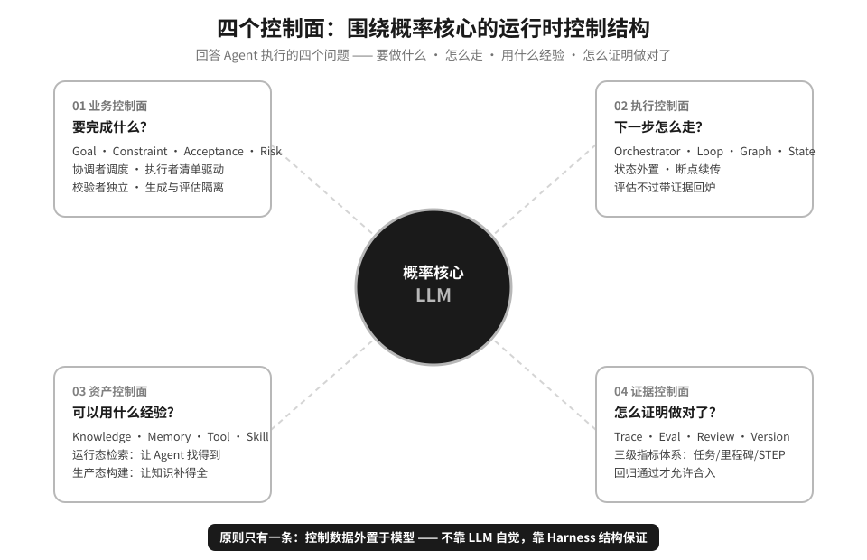
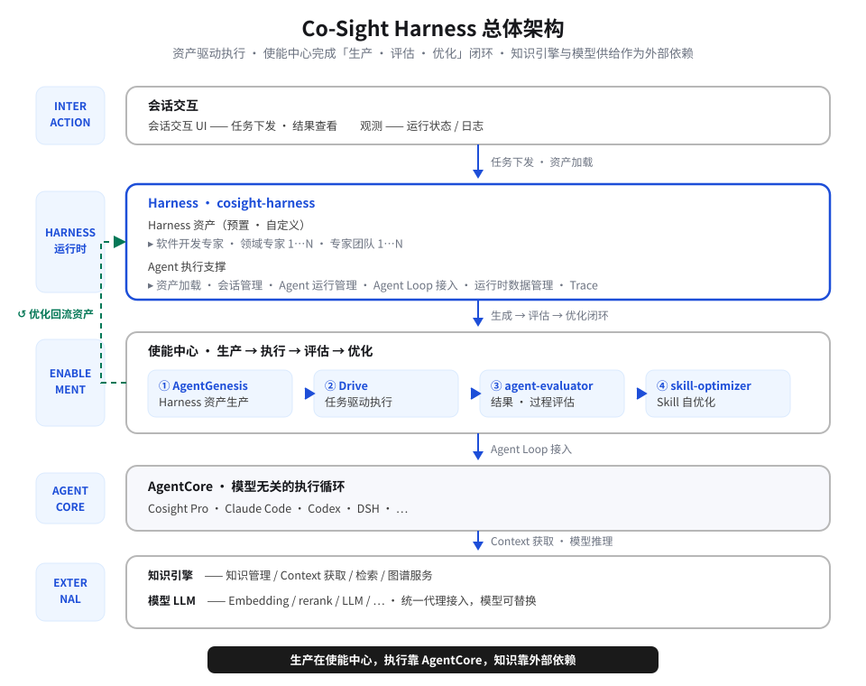

<div align="center">

# Co-Sight Harness

**围绕模型的 Agent 运行时控制结构**

[简体中文](README.md) · [English](README.en.md)

[快速开始](QUICKSTART.md) · [架构](#架构总览) · [组件](#组件清单) · [文档](#文档)

<br/>


</div>

---

Co-Sight Harness 是一个**本地优先**的 Agent 宿主：把 Claude Code、Codex、DSH 这类 Agent
运行时串在同一个前后端外壳里，用一套可版本化、可审计的控制数据（目标、状态、上下文、工具、
权限、验证、证据）托住长链路、知识密集的业务任务——让它们跑出 Demo 之外的稳定性。

它做的，就是**围绕模型的那层控制结构**。

```bash
# 源码态：两条命令起框架（详见 QUICKSTART.md）
pnpm install && pnpm dev

# 分发包：解压后，两条命令跑起来
./install.sh && ./start.sh
```

---

## 目录

- [这是什么](#这是什么)
- [为什么需要它](#为什么需要它)
- [核心能力](#核心能力)
- [架构总览](#架构总览)
- [仓库结构](#仓库结构)
- [快速开始](#快速开始)
- [组件清单](#组件清单)
- [环境要求](#环境要求)
- [源码开发](#源码开发)
- [文档](#文档)
- [贡献](#贡献)
- [许可证](#许可证)
- [致谢](#致谢)

---

## 这是什么

Coding Agent 之所以稳，是因为编译器、测试、CI 是现成的裁判，分钟级闭环。
真实业务 Agent——需求分析、方案设计、波及评估——链路跨小时跨天、知识密集、反馈模糊，
没有现成裁判。单步质量再高，误差也会沿链路连乘，目标逐步漂移。

Co-Sight Harness 把这个问题的解法放在**模型之外**：状态、约束、验收标准不靠 LLM 自觉，
而由 Harness 结构保证。围绕概率核心，它建立四个控制面：

| # | 回答的问题 | 控制面 | 能力 |
|:---:|:---|:---|:---|
| `01` | 要完成什么？ | **业务控制面** | Goal · Constraint · Acceptance · Risk：拆解巨石 Skill，协调者调度流程、执行者清单驱动、校验者剥离确定性逻辑，生成与评估隔离 |
| `02` | 下一步怎么走？ | **执行控制面** | Orchestrator · Loop · Graph · State · Checkpoint：控制层调度流水线，状态外置、断点续传，评估不过带证据回炉 |
| `03` | 可以用什么经验？ | **资产控制面** | Knowledge · Memory · Tool · Skill · Policy：运行态检索让 Agent 找得到，生产态构建让知识补得全 |
| `04` | 怎么证明做对了？ | **证据控制面** | Trace · Eval · Review · Version · Rollback：三级指标体系，评测闭环决定改什么，回归通过才允许合入 |

> **原则只有一条：控制数据外置于模型。**



---

## 为什么需要它

单步 95% 的质量，十步串行之后只剩 60%：

```text
  0.95 × 0.95 × … × 0.95  ≈  0.60

  STEP 1  ██████████████████▋░  95%
  STEP 5  ███████████████▎░░░░  77%
  STEP 10 ████████████▋░░░░░░░  60%   ← 实测端到端无人干预任务完成率约 50%
```

不确定性来自三个方向，且沿链路放大：

| 来源 | 表现 |
|:---|:---|
| `LLM` 概率输出 | 同样的输入不保证同样的路径；目标漂移逐步累积，错误沿链路传导 |
| `USER` 约束在脑子里 | 验收标准与边界条件不显式说出，模型只能靠猜；验收口径缺失的地方，质量全靠人盯场 |
| `ENV` 供给不稳定 | 知识分散、工具与权限受限、调用有时延；知识在库里却够不着 |

Harness 的解法是**让误差不再连乘**：给每一步设门禁，过得了才流转，过不了带证据回炉。
10 步的连乘，被拆成 10 次独立过关。

```text
CONTROLLED EXECUTION LOOP

 ┌──────────┐    ┌────────┐    ┌─────────┐    ┌────────────┐
 │ ANALYSIS │ ─▶ │  PLAN  │ ─▶ │ EXECUTE │ ─▶ │ EVALUATION │
 │ 澄清·审查 │    │ 规划·拆分│    │ 调度·执行 │    │ 测试·评估·门禁│
 └──────────┘    └────────┘    └─────────┘    └────────────┘
      ▲                                            │
      └──────────  评估不通过，带证据回到起点  ◀──────┘
```

---

## 核心能力

| 能力 | 说明 |
|:---|:---|
| **执行者不给自己打分** | 生成与评估隔离：校验者独立于执行者，确定性逻辑从提示词剥离到 Hook 与脚本，DOD 审查通过才推进 |
| **链路跨天，状态不用重讲** | 状态与检查点全部外置；任务今天停了，明天从断点继续，上下文、决策记录与过程产物一件不丢 |
| **人力按置信度退出** | 低置信人工兜底，中置信 LLM 校验 + 抽检，高置信脚本 / grep / Schema 零人工；高风险与未知类型永远保留人工兜底 |
| **会描述需求，就能得到控制数据** | 口语化需求经转化层变成任务定义、可执行检查（DOD）与领域技能，上手无需理解内部规范 |
| **改配置，不改代码** | 策略与规则独立版本化；每次变更可评测、可回滚，影响分析 + 回归 Eval |
| **越用越快** | 每次创建都在沉淀资产：新用例搭建从 2–4 小时降到 5–10 分钟 |

真实业务验收数据：

| 维度 | 指标 | 前后对比 | 提升 |
|:---:|:---|:---:|:---:|
| 效率 | 需求分析耗时 | `169 分钟` → **56.4 分钟** | `-67%` |
| 效率 | 子系统设计耗时 | `114 分钟` → **26.5 分钟** | `-77%` |
| 质量 | 场景子任务 F1 | `68%` → **91.25%** | `+34%` |
| 可靠性 | 任务完成率 | `50%` → **100%** | `+100%` |

---

## 架构总览

Harness 资产驱动执行，使能中心完成「生产 · 评估 · 优化」闭环，知识引擎与模型供给作为外部依赖：



> 生产在使能中心，执行靠 AgentCore，知识靠外部依赖。

---

## 仓库结构

```text
cosight-harness/
├── framework/        # 框架宿主外壳：server/（Fastify API）+ web/（统一外壳）+ shared/（契约层）
├── drive/            # 声明式多 Agent 编排引擎（Claude Code / DSH 插件）
├── agent-genesis/    # 需求 → Agent / Skill 资产生成插件
├── agent-evaluator/  # Agent 评估插件（安装 ID 为 goldeval）
├── skill-optimizer/  # Skill 评测-优化循环插件
├── cosight-bot/      # CoSightBot：知识管理 / 标书应答插件
├── cosight-viewer/   # 任务中心：会话观测 + 任务管理（本地服务）
├── smart-factory/    # 智慧工厂：智能体创建 / 预览 / 评估 UI（本地服务）
├── dsh-compat/       # 把五个插件挂到 DeepSeek Harness 的兼容层
├── install-dsh.sh    # 一条命令把五个插件装进 dsh
├── package.json      # 工作区根：pnpm workspace + 仓库级脚本
└── pnpm-workspace.yaml
```

**组件约定**（新增组件时请遵守）：

- 顶层目录一律 **kebab-case**，与组件英文名一一对应。
- **插件类组件**沿用 Drive 的内部布局：`.claude-plugin/` + `agents/` + `skills/` + `hooks/` + `tests/`。
- **服务类组件**一般含 `server/`、`web/`、`docker-compose.yml`、`docs/`。
- 模块根不放 `package.json`：服务类组件的内部布局按服务特性定，**所有 pnpm 命令在仓库根执行**。
- 组件信息登记在各自目录下的 `.claude-plugin/plugin.json`（插件）或模块清单里（服务）。

---

## 快速开始

两条路径，按你的身份选；完整步骤、异常处理与验收清单见 **[QUICKSTART.md](QUICKSTART.md)**。

**路径 A · 使用分发包**（不需要 pnpm、不需要构建、不需要联网）：

```bash
tar -xzf cosight-harness-*.tar.gz      # Windows：右键「全部解压缩」
cd cosight-harness-*/
./install.sh                           # 检查 + 建数据目录 + 生成配置 + 装五个插件
./start.sh                             # 启动框架与全部模块，逐个探活
# 打开 http://127.0.0.1:4300
```

Windows 下依次双击 `install.cmd`、`start.cmd`。

**路径 B · 从源码启动**（开发 / 二次开发）：

```bash
git clone https://github.com/ZTE-AICloud/Co-Sight.git
cd "Co-Sight/Co-Sight Harness"
corepack enable && pnpm install        # Node ^22.19.0 || >=24.0.0，pnpm 11.28.5
pnpm dev                               # 框架：后端 4300 + 前端热更新 4310
# 打开 http://localhost:4310
```

想让模块（cosight-viewer、smart-factory）一起起来，用总启动（需先按各模块 README 装好依赖）：

```bash
pnpm dev:all
```

---

## 组件清单

| 组件 | 形态 | 说明 | 版本 |
|:---|:---:|:---|:---:|
| [`framework/`](framework/) | 服务 | 统一入口：左侧栏 + 工作区 + 模块 iframe 宿主 + 模块面 API | `0.1.0` |
| [`cosight-viewer/`](cosight-viewer/) | 服务 | 任务中心：Claude Code 会话观测与任务管理（单机版） | `1.2.1` |
| [`smart-factory/`](smart-factory/) | 服务 | 智慧工厂：对话式构建、预览与评估 Agent | `0.1.0` |
| [`drive/`](drive/) | 插件 | 声明式多 Agent 编排引擎，`phase` / `dag` 两种编排模式 | `2.3.4` |
| [`agent-genesis/`](agent-genesis/) | 插件 | 自然语言需求 → 完整可运行的 Agent / Skill（Claude Code 与 DSH 双平台） | `0.23.0` |
| [`agent-evaluator/`](agent-evaluator/) | 插件 | 黄金集评测、E2E 用例生成 / 执行 / 评分、trace 轨迹审计（安装 ID `goldeval`） | `1.0.0` |
| [`skill-optimizer/`](skill-optimizer/) | 插件 | Skill 评测-优化循环：评测 → 缺口分析 → 优化 → 再评测 | `1.0.0` |
| [`cosight-bot/`](cosight-bot/) | 插件 | CoSightBot：个人知识管理专家 + 标书应答专家（安装 ID `cosightbot`） | `0.1.0` |
| [`dsh-compat/`](dsh-compat/) | 兼容层 | 把上面五个插件挂到 DeepSeek Harness 原生表面 | — |

五个 Claude Code 插件的安装 ID 是 `<插件名>@<marketplace 名>`，**不是目录名**：
`drive@zte-ai-lab`、`agent-genesis@agent-genesis`、`goldeval@goldeval`、
`skill-optimizer@skillx`、`cosightbot@cosightbot`。

---

## 环境要求

| 项 | 要求 | 说明 |
|:---|:---|:---|
| `Node.js` | `^22.19.0` 或 `>=24.0.0` | 与服务端 `engines` 一致；版本不符时安装自检会直接给出下载地址 |
| `pnpm` | `11.28.5` | 仅源码开发需要；版本写在根 `package.json` 的 `packageManager`，用 `corepack enable` 对齐 |
| `Claude Code` | CLI `>= 2.1.287` | 分发包安装脚本用它装五个插件；不装可用 `--skip-plugins` 跳过 |
| `Python 3` | PATH 上有 `python3` | 插件 hooks 与 cosight-bot 脚本需要 |
| 平台 | Linux x64 / Windows x64 | 一份归档同时含两个平台的原生件 |

---

## 源码开发

所有命令都在**仓库根**执行（`framework/` 下没有 `package.json`）。

| 命令 | 作用 |
|:---|:---|
| `pnpm dev` | 开发态起框架：后端 4300 + 前端 4310（`/api` 由 Vite 代理到 4300） |
| `pnpm dev:server` / `pnpm dev:web` | 只起后端 / 只起前端（watch 模式） |
| `pnpm dev:all` | 总启动：框架 + 已登记模块（cosight-viewer 4830、smart-factory 4100/4110），每步等就绪，Ctrl-C 逆序全停 |
| `pnpm build` | 构建前端产物（`server` 的 build 只做类型检查） |
| `pnpm start` | 以产物形态运行：托管 `web/dist` + API，同源 4300 |
| `pnpm typecheck` / `pnpm lint` | `tsc --noEmit` / `oxlint` |
| `pnpm test` | 脚本测试 + 各包测试 |
| `pnpm test:coverage` | 覆盖率（阈值 80%） |
| `pnpm verify` | **提交前门禁**：typecheck + lint + 全部测试 |
| `pnpm package` | 打出交付归档（`tar.gz` + `zip`，`.package/`） |
| `pnpm smoke:package` | 独立解压、模拟安装与启动，断言各端口 HTTP 可达 |

数据目录默认 `~/.cosight-harness`（`COSIGHT_HOME`），首次启动自动创建并执行迁移。

---

## 文档

| 文档 | 内容 |
|:---|:---|
| [QUICKSTART.md](QUICKSTART.md) | **先看这份**：分发包与源码两条上手路径、端口、配置、常见问题、卸载 |
| [`framework/docs/user-guide.md`](framework/docs/user-guide.md) | 打包 → 安装 → 启动一条线；给测试同学的验收清单与常见问题 |
| [`framework/docs/operations-manual.md`](framework/docs/operations-manual.md) | 操作手册：出包、安装、启动、配置、自检、卸载与命令速查 |
| [`framework/docs/packaging.md`](framework/docs/packaging.md) | 产物打包与跨平台安装：原生件机制、打包期断言、Windows 验收清单 |
| [`framework/docs/uninstall-manual.md`](framework/docs/uninstall-manual.md) | 卸载：插件与载荷副本、三步卸载、退出码与手工兜底 |
| [`framework/docs/dev-all.md`](framework/docs/dev-all.md) | 总启动脚本：启动顺序、端口冲突归因、加新模块的步骤 |
| [`framework/docs/module-facing-api.md`](framework/docs/module-facing-api.md) | 模块面接口：模型、工作区、知识库路由 |
| [`framework/docs/module-artifact-integration.md`](framework/docs/module-artifact-integration.md) | 模块进产物要满足什么、清单怎么写 |
| [`framework/docs/plugin-install.md`](framework/docs/plugin-install.md) | 五个插件装了什么、装到哪、怎么排障 |
| [`dsh-compat/README.md`](dsh-compat/README.md) | 把五个插件装进 DeepSeek Harness（dsh） |

各组件的架构、配置与接口文档在各自目录的 `README.md` 与 `docs/` 下。

---

## 贡献

欢迎 issue 与 pull request。

| 事项 | 约定 |
|:---|:---|
| 提交信息 | `<type>: <description>`，type ∈ `feat / fix / refactor / docs / test / chore / perf / ci` |
| 提交前门禁 | `pnpm verify`（typecheck + lint + 测试，覆盖率阈值 80%）必须通过 |
| 新增组件 | 遵守[组件约定](#仓库结构)：kebab-case 目录、插件 / 服务两种布局、组件信息登记在 `plugin.json` |
| 新增模块接入 | 先在 `framework/docs/modules/` 登记清单，再按 [`module-artifact-integration.md`](framework/docs/module-artifact-integration.md) 决定是否进产物 |
| 安全 | 不提交明文密钥；凭据只走环境变量或数据目录下的 `.credentials.yaml` |
| PR | 描述里写明动机、改动范围与测试方式；涉及行为变化请同步更新对应文档 |

---

## 许可证

本项目以 [Apache License 2.0](LICENSE) 发布，Copyright 2026 ZTE Corporation。
各组件目录下的 `LICENSE` 与根许可证一致；第三方组件声明见
[`THIRD-PARTY-NOTICES.md`](THIRD-PARTY-NOTICES.md)。

本发行物**不包含、不分发** Anthropic 的 Claude Agent SDK 或 Claude Code CLI。需要真实执行
能力时，由用户在自己的运行机上安装 Claude Code CLI 并接受 Anthropic 的条款；未安装时，
各模块的创建、管理与浏览功能照常可用，运行入口会给出安装指引。

---

## 致谢

本仓库的 [`cosight-viewer/`](cosight-viewer/) 组件在设计与实现中参考并复用了开源项目
[**Claude-Code-Agent-Monitor**](https://github.com/hoangsonww/Claude-Code-Agent-Monitor)
（MIT License，Copyright (c) 2026 - Now, Son Nguyen）的部分代码。谨向该项目及其作者、社区致以谢意。

按 MIT 许可证要求，上游版权声明与许可声明已完整保留于 [`cosight-viewer/NOTICE`](cosight-viewer/NOTICE)。

---

<div align="center">

### 给你们的 Agent，装上控制结构。

`低成本立起` · `可控地跑` · `越跑越聪明`

<sub>`Co-Sight Harness` · Built with control, not luck.</sub>

</div>
