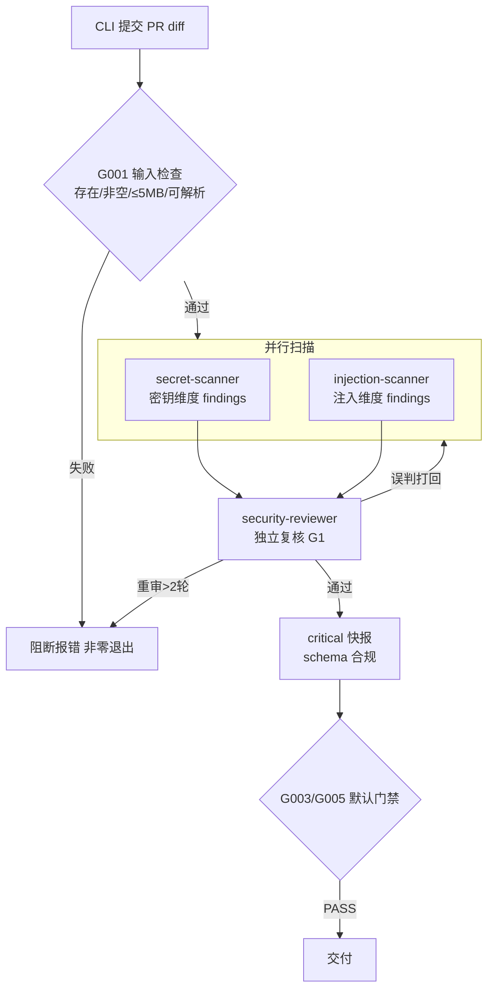

# DC-001 人审展示面 — pr-security-reviewer

> 本文件是 DC-001 go/no-go 审批的完整展示材料。批准即授权 agent-executor 按 build-plan.md 生成全部文件。

## 1. 概述

从 PR 的 git diff 出发，按固定四步流程完成安全审查并输出 critical 问题快报的 CLI 批处理 Agent。提交即出结果，全程无人工交互。

## 2. 核心能力

- 密钥硬编码扫描：AWS AKIA / Slack xoxb / PEM 私钥头 / 连接串口令等模式清单命中即 critical
- 注入漏洞扫描：SQL 字符串拼接、exec/eval/system 调用、用户输入直插命令
- 独立复核：独立 Reviewer 对每条 critical 判定做证据复核，误判打回修正（重审 ≤2 轮，超限阻断）
- 结构化快报：按统一 schema 输出（维度/位置/证据/修复建议）；无 critical 时输出明确「无 critical 问题」结论

## 3. 交付计划

| 批次 | 内容 | 数量 |
|------|------|:---:|
| 编排层 | CLAUDE.md、proposal-spec.md、settings.json | 3 |
| 执行层 | secret-scanner、injection-scanner、security-reviewer 三个 SubAgent + findings schema | 4 |
| 工作流/门禁 | phase-1-security-scan.md、G001 输入门禁、G003/G005 默认门禁、gates.yaml | 4 |
| 质量与资产 | pass-criteria、matching-decision-review、6 通用规则、hooks.json | 8（6 拷贝+2 生成） |

共 16 项；其中确定性直拷 7 项（g025，零 LLM 生成），LLM 生成 8 项，存在性校验 1 项。

## 4. 文件清单（含角色/生成方式）

| # | 路径 | 角色 | 生成方式 |
|---|------|------|---------|
| 2 | proposal-spec.md | 构建方案（本审批展示面） | LLM 生成 |
| 3 | CLAUDE.md | Agent 主调度器（8 章） | LLM 生成 |
| 4 | phase-1-security-scan.md | 运行时步骤编排 | LLM 生成 |
| 5 | phase/02-workflows/phase-1-security-scan.md | 核心扫描四步工作流 | LLM 生成 |
| 6 | .claude/agents/secret-scanner.md | 密钥扫描 SubAgent | LLM 生成 |
| 7 | .claude/agents/injection-scanner.md | 注入扫描 SubAgent | LLM 生成 |
| 8 | .claude/agents/security-reviewer.md | 独立复核 SubAgent | LLM 生成（asset_adapt critic.md 骨架） |
| 9 | .claude/schemas/security-findings.schema.json | findings 结构契约 | LLM 生成 |
| 10 | phase/gates/G001-input-check.md | 输入门禁 | LLM 生成 |
| 11 | phase/gates/G003-readiness-score.md | 就绪度门禁（默认） | LLM 生成 |
| 12 | phase/gates/G005-no-placeholders.md | 占位符门禁（默认） | LLM 生成 |
| 13 | phase/gates/gates.yaml | gate 触发映射 | LLM 生成 |
| 14 | phase/review/matching-decision-review.md | 审查规则 | 直拷 |
| 15 | .claude/rules/*.md ×6 | 通用规则 | 直拷 |
| 16 | .claude/hooks/hooks.json | hook 配置 | 直拷（整包单文件，无外部脚本引用） |
| 17 | .claude/settings.json | 项目设置 | LLM 生成 |
| 18 | evaluation/pass-criteria.md | 通过标准 | LLM 生成 |

## 5. 已知风险（≥2）

1. **skills=0 偏差**：结构决策为 0 skill（YAGNI），与 agent-output-standard 默认「≥1 asset_adapt skill」冲突。缓解：v2 结构约束优先，偏差在此显式声明；若后续需要可增量补 skill。
2. **critical-only 可能漏报**：只报 critical 级别，medium/low 风险不输出，用户可能误以为"审查通过=无问题"。缓解：报告尾部固定说明"仅覆盖 critical 级判定"；G1 复核环节校验 evidence 真实性降低误报。
3. **LLM 静态分析误报**：密钥/注入特征清单基于模式匹配，对混淆代码可能误报或漏报。缓解：G1 独立复核必须验证证据片段真实存在于 diff 对应位置。
4. **三维扫描覆盖面**：危险配置维度未建独立扫描器（仅两扫描器+复核），依赖 reviewer 兜底。缓解：接受——首批聚焦密钥/注入最高危维度。

## 6. Spot-check 锚点（≥3，可执行）

| # | 锚点 | 执行方式 |
|---|------|---------|
| 1 | security-reviewer 的 forbidden_inputs 是否含三维扫描器中间推理文件 | grep -A5 forbidden_inputs output/agents/pr-security-reviewer/v1/.claude/agents/security-reviewer.md → 应见 secret-scanner/injection-scanner 产物路径 |
| 2 | 回压协议是否闭环 | grep "重审≤2轮" phase/02-workflows/phase-1-security-scan.md → 命中且含超限阻断语义 |
| 3 | schema required 字段 | python3 -c "import json;s=json.load(open('.claude/schemas/security-findings.schema.json'));assert set(s['required'])>={'dimension','severity','location','evidence','fix'}" → exit 0 |
| 4 | 干净 diff 不误报路径 | grep "无 critical 问题" phase/02-workflows/phase-1-security-scan.md → 命中 |
| 5 | 产物无插件内部裸路径 | grep -rE "knowledge/|design/" output/agents/pr-security-reviewer/v1/CLAUDE.md 中无前缀裸引用 → 空 |

## 7. 验收标准（acceptance_criteria 映射）

| AC | 判据 | 验证落点 |
|----|------|---------|
| AC1 硬编码 API key diff → critical 报告 | planted fixture：diff 含 `AKIA...` → 输出 critical（维度 secrets、含位置/证据/修复建议） | secret-scanner 模式清单含 AKIA + schema required 四字段 + pass-criteria planted 判据 |
| AC2 SQL 字符串拼接 diff → injection critical | planted fixture：diff 含字符串拼接 SQL → 输出 critical（维度 injection） | injection-scanner 特征清单含「字符串拼接」+ invariants content_contains 锚定 |
| AC3 干净 diff → 「无 critical 问题」零误报 | planted fixture：干净 diff → 输出明确「无 critical 问题」，不得有任何 critical | reviewer 复核职责 + workflow 空发现路径 + invariants 锚定 |

## 8. 架构决策摘要

- **multi_agent 三维拆分**：两专职扫描器（并行）+ 一独立复核者，而非单 Agent 全包——复核独立性（G1 game mechanism）要求复核者看不到扫描器推理，只有独立上下文隔离能做到。
- **critical-only 快报**：用户显式选择"仅 critical 问题快报"（DC-010 澄清结果），medium/low 不进报告。
- **固定四步流程**：输入检查 → 并行扫描 → 独立复核 → 结构化报告；无路由、无动态派生。
- **无人工交互**：提交即出结果，输入问题直接阻断报错而非询问。

## 9. 决策物化摘要（≤20 行）

| 决策 | 物化位置 |
|------|---------|
| 固定四步流程 | phase-1-security-scan.md 步骤表 |
| 复核独立性 | security-reviewer forbidden_inputs 双向隔离 |
| 回压重审 ≤2 轮 | phase-1-security-scan.md Step 3 + reviewer 执行流程 |
| 结构化输出契约 | .claude/schemas/security-findings.schema.json（五字段必填） |
| 输入前置阻断 | phase/gates/G001-input-check.md（blocking, retry 0） |
| 只读审查隔离 | CLAUDE.md 禁止操作清单 + settings.json 写权限收窄 |
| 无外部知识 | CLAUDE.md 知识节 K1 声明 |
| 默认质量门禁 | G003 readiness≥58 / G005 placeholder==0（fallback 生效） |

## 10. 判断题清单（≤7，机检标注）

1. 复核者与扫描者的上下文是否双向隔离？【机检 ✓ G009/G023 + spot-check #1 grep】
2. 回压重审是否有上限且超限阻断？【机检 ✓ content_contains「重审≤2轮」】
3. schema 是否五字段全必填且 JSON 合法？【机检 ✓ G023 json_schema_valid】
4. 产物是否含插件内部裸路径？【机检 ✓ G023 cross 校验】
5. 干净 diff 路径是否有明确「无 critical 问题」输出？【机检 ✓ content_contains】
6. 输入异常是否阻断而非猜测续跑？【机检 ✓ G001 blocking: true】
7. 7 个直拷文件是否与源逐字一致？【机检 ✓ G025 确定性直拷】

## 11. 拓扑图

