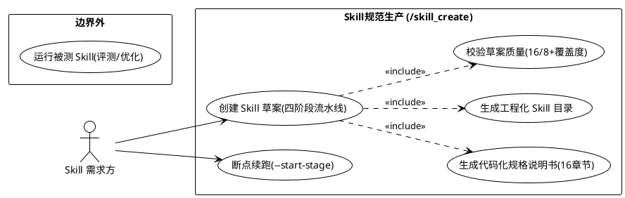
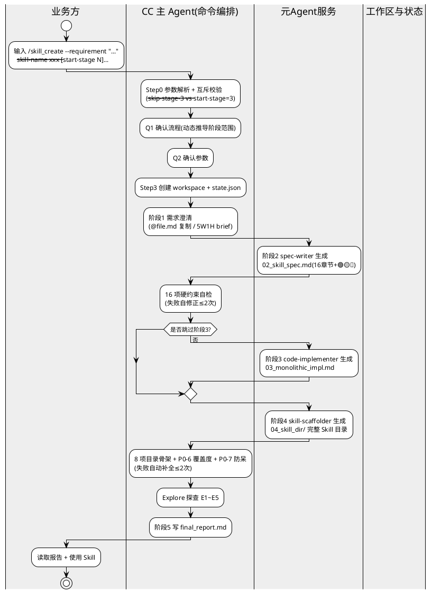
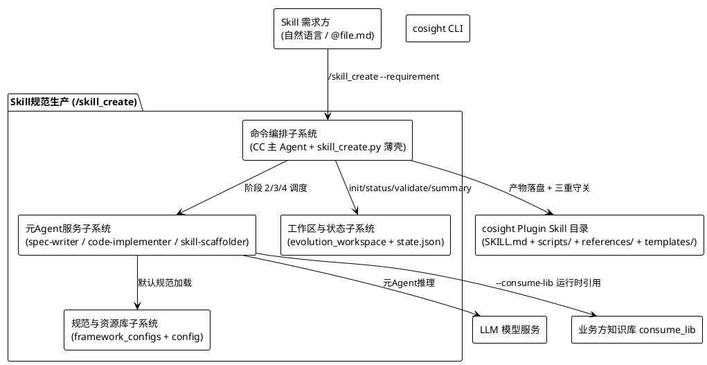
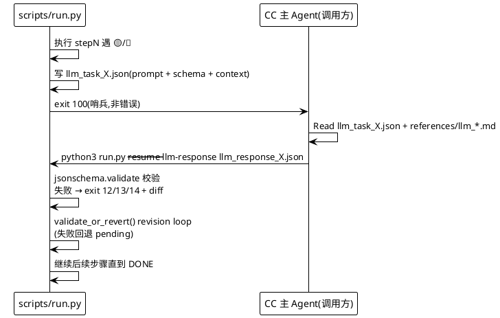
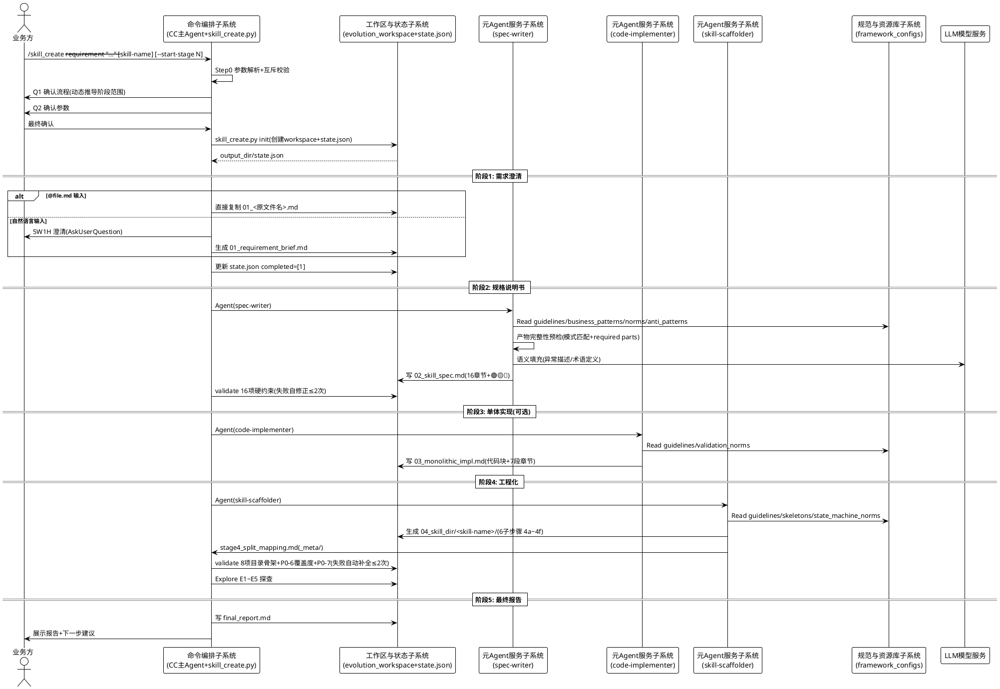
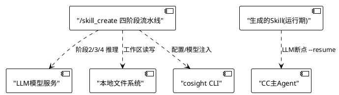

| **文档类型** | 需求方案模板 |
| --- | --- |
| **方案类型** | 大需求方案（工作量≥15天） |
| **BA** | <br> |
| **领域** | CoSight Pro / 元Agent服务 |
| **承接团队** | <br> |
| **需求名称** | 【子需求】【CoSight Pro】【下一代智慧工厂-Skill规范生产】支持高质量Skill规范化生产以及优化——元Agent服务Skill草案生成 |
| **规划release** | <br> |
| **模板版本** | 2024-09-04 |

# 变更记录
| **日期** | **提出人** | **版本** | **需求号/EC** | **变更要点** |
| --- | --- | --- | --- | --- |
| 2026-08-11 | 李伟山 | V1.0 | — | 变更点：新增 `/skill_create` 命令方案设计（ADC）；变更章节：3 方案设计 |

# 外部关键参与人
| **角色** | **姓名** | **部门** | **填写备注** |
| --- | --- | --- | --- |
| 需求提出人 | <br> | <br> | 提出人或代表人员必须参加，不一定是直接提需求的人 |
| 协同项目人员 | <br> | <br> | 涉及协同项目时必填 |

# 1 需求分析
## 1.1 需求背景
<div type="highlight">
1、章节说明：需要写明**<用户>**在**<什么应用场景下>**遇到**<问题和痛点>**，希望达成的**<价值&目标>**。
2、编写方式：人工编写，和MR中的需求描述同步。
</div>

**Skill 规范生产（0→1）**：
- **用户**：Skill 需求方（业务领域专家 / AI 应用工程师 / 研发工程师）。
- **应用场景**：在 CoSight Pro 平台上手工制作一个"可被 CC 调用的 cosight Skill"（`SKILL.md` + `scripts/` + `references/` + `templates/`）。
- **问题&痛点**：手工制作 Skill 高度依赖经验：需要拆步骤、标代码化属性（🟢/🟡/🔴）、设计 LLM 断点契约、满足 16 项硬约束与目录骨架规范，产出一份合格 Skill 通常要数天，且规范理解不一致导致质量参差。
- **价值&目标**：提供**元 Agent 服务 Skill 草案生成**能力——用户输入 1 条自然语言需求（可附 `@file.md` 原文件 / 知识库路径），`/skill_create` 命令自动编排 4 阶段流水线产出**规范化的 Skill 草案**（含规格说明书 + 工程化目录 + 最终报告），质量由 16/8 项硬约束 + 覆盖度统计三重守关，显著降低 Skill 生产门槛与耗时。

## 1.2 场景分析
1、章节说明：基于【需求背景】对应用场景的细化和分层，识别出具体的业务场景。
2、编写方式：人工填写，后面考虑使用AI生成（待实现）。
3、信息流转：基于【需求背景】中的<应用场景>。

**场景1：从自然语言需求创建 Skill（全流程）**
- 用户：Skill 需求方
- 场景描述：用户提供一条自然语言需求（如"做一个读取 Excel 生成 Markdown 表格的 skill"），希望得到可直接使用的 cosight Skill 草案。
- 前置条件：`/skill_create` 命令可用；`SKILLX_ROOT` / `SKILLX_WORKSPACE` 环境变量或 `config/create-user-config.yaml` 已配置。
- 后置条件：`evolution_workspace/skill_create_<ts>/` 下生成 `04_skill_dir/{skill-name}/` 完整 Skill 目录 + `final_report.md`。
- 操作步骤：
  - N0010 输入 `/skill_create --requirement "..."`（或 `--requirement @file.md`）
  - N0020 通过 Q1/Q2 二次确认阶段范围与参数
  - N0030 自动执行阶段 1（需求澄清）→ 2（规格说明书）→ 3（单体实现，默认跳过）→ 4（工程化）→ 5（最终报告）
  - N0040 读取最终报告，校验产物目录后使用该 Skill
- 验收准则：

| GIVEN | WHEN | THEN |
| --- | --- | --- |
| 用户提供需求 + 已配置环境 | 执行 `/skill_create` 全流程 | 生成含 `SKILL.md`/`scripts/`/`references/`/`templates/` 的 Skill 目录，16/8 项自检通过 |

**场景2：从已有规格说明书恢复（断点续跑）**
- 用户：Skill 需求方
- 场景描述：阶段 2 已完成（`02_skill_spec.md` 已生成），用户中断后希望只跑阶段 3→4。
- 操作步骤：`/skill_create --requirement "..." --start-stage 3 --spec-path <path>`
- 验收准则：

| GIVEN | WHEN | THEN |
| --- | --- | --- |
| 已有 `02_skill_spec.md` | `--start-stage 3` 恢复 | 阶段 1/2 不再执行，直接从阶段 3 开始并正确引用 spec |

## 1.3 解决思路分析
1、章节说明：重点是关键技术、变更点、变更组件、影响功能等。
2、编写方式：基于<MR需求分析报告>补充。

**解决方案思路**：
- **命令编排与业务处理分离**：CC 主 Agent 只做参数解析、Q1/Q2 二次确认、阶段调度、硬约束自检；业务内容由 3 个**元 Agent 服务**（spec-writer / code-implementer / skill-scaffolder）生成，互不耦合、可独立复用。
- **代码化优先（Code-First）**：产物每步骤强制标注 🟢/🟡/🔴，🟢（纯脚本可做）占比 ≥ 50%，LLM 只介入真正语义推理点；LLM 调用走**断点协议**（`llm_task_X.json` → CC 推理 → `llm_response_X.json` → `--resume`）。
- **规范单一来源**：`framework_configs/skill-create-guidelines.md` 作为内置默认规范被 3 个元 Agent 默认加载；用户通过 `config/create-user-config.yaml` + `--expert-guidance` 补充约束，**不重复传规范**。
- **质量三重守关**：阶段 2 后 16 项 spec 硬约束 → 阶段 4 后 8 项目录骨架 + P0-6 覆盖度（6 组交叉对比）+ P0-7 防呆（references/ 文件 >200KB / 目录 >1MB FAIL），全部通过才算完成。

## 1.4 特性域变更分析
<div type="highlight">
1、章节说明：新增需求和存量特性的关联，辅助分析增量需求对存量特性及特性功能的波及影响。
2、编写方式：AI助手从特性库中导出特性以及对应的功能，BA分析该需求对功能的具体变更点。
</div>

| **特性名称** | **类别** | **特性变更类型** | **功能名称** | **功能变更类型** | **变更点** | **操作** |
| --- | --- | --- | --- | --- | --- | --- |
| Skill规范生产 | 特性 | 新增 | /skill_create 四阶段流水线 | 新增 | 从需求 → 规格 → 单体 → 工程化目录全自动 | 编辑 |
| Skill规范生产 | 特性 | 新增 | 代码化规格说明书生成 | 新增 | 16 章节 + 🟢/🟡/🔴 标注 | |
| Skill规范生产 | 特性 | 新增 | 工程化 Skill 目录拆分 | 新增 | 单体重构为 SKILL.md+scripts+references+templates | |
| Skill规范生产 | 特性 | 新增 | 草案质量守关 | 新增 | 16/8 项硬约束 + P0-6 覆盖度 + Explore 探查 | |
| Skill优化（存量） | 特性 | 继承 | /skill_optimize 静态打磨 | 继承 | 以 `04_skill_dir/{skill-name}/SKILL.md` 为输入，无行为变更 | |

## 1.5 系统域变更分析
<div type="highlight">
1、章节说明：系统域变更分析由特性域变更分析中的<功能>及<变更点>注入。
2、编写方式：AI助手从特性库中导出特性下对应的功能以及子系统间的交互，BA分析该需求对子系统的波及。
</div>

| **特性/基站中台** | **用例名称** | **子系统** | **子系统波及说明** | **操作** |
| --- | --- | --- | --- | --- |
| Skill规范生产 | 从自然语言需求创建 Skill（场景1） | 命令编排子系统 | 新增 `/skill_create` 参数解析 / Q1Q2 二次确认 / 阶段调度 / 硬约束自检 | 编辑 |
| Skill规范生产 | 从自然语言需求创建 Skill（场景1） | 元Agent服务子系统 | 新增 3 个元Agent服务（spec-writer / code-implementer / skill-scaffolder），被阶段 2/3/4 调用 | |
| Skill规范生产 | 从自然语言需求创建 Skill（场景1） | 规范与资源库子系统 | 新增 framework_configs 内置默认规范；被 3 个元Agent默认加载 | |
| Skill规范生产 | 从自然语言需求创建 Skill（场景1） | 工作区与状态子系统 | 新增 evolution_workspace 产物目录 + state.json 状态机 + 断点续跑 | |

## 1.6 架构影响分析
本需求是否涉及架构变更：**不涉及**

1、章节说明：对整体架构影响及子系统架构影响。
2、编写方式：BA手工编写。
### 1.6.1 整体架构影响
无整体架构变更。本需求在既有 SkillX Cosight Harness 框架内新增一个命令（`/skill_create`）及其配套元Agent服务，不改动四元闭环（create→optimize→evolve→register）中的存量命令行为。
### 1.6.2 子系统架构影响
新增"命令编排子系统 / 元Agent服务子系统 / 规范与资源库子系统 / 工作区与状态子系统"四个内部子系统，均为新组件，不改变存量子系统（orchestrator / Evaluator / Optimizer）的边界。

# 2 特性设计
## 2.1 特性描述
1、章节说明：该特性是什么，具体包括该特性为哪类用户在什么场景下所提供。

**Skill 规范生产**：为 Skill 需求方提供 **0→1 代码化 Skill 生产**能力。用户输入 1 条自然语言需求（可附原文件/知识库路径），系统自动完成"需求澄清 → 16 章节规格说明书 → 单体 Python 参考实现（可选）→ 工程化 Skill 目录 → 最终报告"全流程，产出可直接被 CC 调用的 cosight Plugin 形态 Skill 草案。产物严格执行代码化优先原则（🟢 ≥ 50%），LLM 仅在语义推理环节介入并走断点协议。

## 2.2 特性价值
1、章节说明：该特性提供的收益，要具体化。
- **效率**：Skill 生产从"数天手工 + 规范逐条核对"缩短到"分钟级一条命令"，阶段 3 可跳过（省约 30% 时间）。
- **质量**：16/8 项硬约束 + P0-6 覆盖度 + Explore 探查自动守关，杜绝"骨架像但行为跑飞"的伪 Skill。
- **可追溯**：每阶段产物可见性强制打印 + `final_report.md` 完整执行轨迹 + `state.json` 断点续跑，审计友好。
- **规范沉淀**：framework_configs 作为单一来源，规范版本可演进（如 v2 断点命名治理），不散落在各 Skill 中。

## 2.3 特性功能列表
1、章节说明：该特性下包含的功能，以及功能对应的业务场景。
| **功能** | **对应业务场景** |
| --- | --- |
| 功能1：Skill 草案自动生成（四阶段流水线） | 场景1 / 场景2 |
| 功能2：代码化规格说明书生成 | 场景1（阶段2） |
| 功能3：工程化 Skill 目录拆分 | 场景1（阶段4） |
| 功能4：草案质量守关 | 场景1（阶段2/4 末尾） |

## 2.4 特性边界设计
1、章节说明：UML用例图+文字描述设计特性边界，用例与【特性功能列表】一一对应。



**边界说明**：`/skill_create` 只**创建** Skill 草案（写工作区，禁止改 live skill_root），不负责运行/评测/优化 Skill（后者由 `/skill_optimize` / `/skill_evolve` 承接）；生成的脚本只写不跑，由调用方验证后再用。

## 2.5 功能设计
1、章节说明：功能的业务流程打开，使用UML跨职能流程图+流程文字描述（体现参数）。
2、编写方式：AI助手从特性库中导出功能设计章节。



## 2.6 特性依赖分析
1、章节说明：分析该特性的依赖分析（影响 / 排斥）。
| **页面标题** | **功能说明** |
| --- | --- |
| /skill_optimize（存量） | 影响：/skill_create 产物 `04_skill_dir/` 作为 /skill_optimize 的静态打磨输入，生成产物必须满足其目录规范 |
| /skill_evolve（存量） | 影响：/skill_create 生成 Skill 供评测驱动优化（四元闭环），产物需含可运行的 `scripts/run.py` |
| LLM 模型服务 | 影响：阶段2/3/4 的元Agent推理依赖 LLM API，模型不可用时降级写 `.skipped.md` |
| cosight CLI | 影响：`config/create-user-config.yaml` + 环境变量提供路径派生与模型注入 |

# 3 方案设计
**需求整体方案说明：**



#### 1.目标
| **目标** | **说明** |
| --- | --- |
| 插件化交付 | 作为 cosight 内置命令发布，提供 `/skill_create` 命令入口（薄壳 `scripts/commands/skill_create.py`） |
| 代码化优先 | 产物每步骤强制标注 🟢/🟡/🔴，🟢（纯脚本可做）占比 ≥ 50%，LLM 只在语义推理点介入 |
| 分阶段实施 | 阶段 1 需求澄清 → 2 规格说明书 → 3 单体实现（可选）→ 4 工程化 → 5 最终报告，支持 `--end-stage` 提前止损 |
| 产物规范标准化 | 16 章节规格说明书 + 8 项目录骨架 + 06 组覆盖度统计，字段/目录/校验规则明确 |
| 断点续跑 | `state.json` 状态机 + `--start-stage N`，中断可从中间阶段恢复 |
| 解耦规范与内容 | framework_configs 作为规范单一来源，3 个元Agent默认加载；内容由业务方输入 + `--expert-guidance` 提供 |

#### 2.总体架构
**2.1 数据流**

`/skill_create` 采用"需求（input）→ 阶段流水线 → Skill 目录（output）"的分层模型。业务方只需提供需求与可选知识库路径，产物全部落在 `evolution_workspace/skill_create_<ts>/`：

```text
┌────────────────────────────┐     ┌──────────────────────────────┐
│ 需求输入                    │────▶│ evolution_workspace/         │
│ {--requirement,  @file.md} │     │ skill_create_<ts>/           │
│ {--skill-name, --expert-   │     │ 01_<brief|原文件>.md  (阶段1) │
│  guidance, --consume-lib}  │     │ 02_skill_spec.md     (阶段2) │
└────────────────────────────┘     │ 03_monolithic_impl.md(阶段3) │
        │                          │ 04_skill_dir/<skill-name>/   │
        ▼                          │   ├── SKILL.md               │
┌────────────────────────────┐     │   ├── scripts/run.{py,sh}    │
│ CC 主 Agent(命令编排)        │     │   ├── scripts/step{N}.py    │
│ ├─ Step0 参数解析+互斥校验   │     │   ├── references/*.md       │
│ ├─ Q1/Q2 二次确认            │     │   ├── references/          │
│ ├─ 阶段调度(1→5)             │     │   │   llm_{id}_{meaning}.md│
│ ├─ 16/8 项硬约束自检         │     │   ├── templates/*.md       │
│ └─ Explore E1~E5 探查        │     │   └── _meta/(辅助元信息)     │
└────────────────────────────┘     ├── state.json                 │
        │                          └── final_report.md            │
        ▼
┌────────────────────────────┐
│ 元Agent服务(内容生成)        │
│ ├─ spec-writer    (阶段2)   │
│ ├─ code-implementer(阶段3)  │
│ └─ skill-scaffolder(阶段4)  │
└────────────────────────────┘
```

**核心原则**：
- **框架与内容分离**：CC 主 Agent 只编排与守关，内容由 3 个元Agent服务按内置默认规范生成；
- **规范单一来源**：`framework_configs/skill-create-guidelines.md`（内置默认规范）+ `business_patterns.yaml`（业务模式）+ `llm_breakpoint_templates.json`（断点模板库）+ `norms/` + `anti_patterns/`；
- **工作区隔离**：产物只落 `evolution_workspace/`，严禁写 live skill_root；
- **代码化优先**：能写代码就不让 LLM 推理；LLM 断点走 `llm_task_X.json → CC → llm_response_X.json → --resume` 协议。

**2.2 状态机（state.json）**

```text
┌────────┐   init    ┌──────────┐ 阶段完成  ┌──────────────┐
│ 未创建  │─────────▶│ 阶段1运行 │─────────▶│ completed=[1] │
└────────┘           └──────────┘           └──────────────┘
   │                     │                        │
   └──--start-stage N──▶ │   ┌────────────────────┘
                         ▼   ▼
              ┌─────────────────────┐
              │ 阶段 N 运行 → 产物自检 │──通过──▶ completed.append(N)
              └─────────────────────┘   │
                      │ 失败             │
                      ▼                 ▼
              ┌───────────────┐   ┌───────────┐
              │ 自修正(≤2次)    │◀─▶│ 标记失败    │
              └───────────────┘   └───────────┘
```

#### 3. 工程结构
**3.1 命令与资产结构**

```text
cosight-agent-core-skillx-alpha/
├── 
│   ├── commands/skill_create.md        # /skill_create 命令契约(参数/流程/12硬约束)
│   └── agents/
│       ├── specification-writer-agent.md   # 元Agent服务:阶段2 spec
│       ├── code-implementer-agent.md       # 元Agent服务:阶段3 impl
│       └── skill-scaffolder-agent.md       # 元Agent服务:阶段4 scaffold
├── scripts/commands/skill_create.py    # 薄壳(init/status/validate/summary/check-completeness)
├── framework_configs/                  # 规范与资源库(单一来源)
│   ├── skill-create-guidelines.md      # 内置默认规范(代码化优先/断点协议/异常/16章节)
│   ├── knowledge/
│   │   ├── business_patterns.yaml      # 业务模式库(flow_design等,含 min_parts)
│   │   └── llm_breakpoint_templates.json  # 断点模板库(insertions/row_updates/...)
│   ├── norms/                          # spec_norms / llm_breakpoint_norms / validation_norms / state_machine_norms
│   └── anti_patterns/skill_anti_patterns.md  # 反模式自查清单
└── config/create-user-config.yaml      # 业务方唯一配置入口(paths.root=${SKILLX_ROOT})
```

**3.2 skill_create.py 薄壳接口**

```python
skill_create.py 子命令(exit code: 0 OK / 1 usage / 2 file-not-found / 3 validation-fail)
├── init                 # 创建 workspace + state.json + 占位文件
├── status               # 读取 state.json 展示进度
├── validate             # 16 项 spec 硬约束 + 8 项目录骨架 + P0-6 覆盖度
├── summary              # 汇总所有产物路径与大小
└── check-completeness   # 通用业务完整性 checklist(不读 reference)
```

**3.3 /skill_create 命令入口**

```markdown
---
name: skill_create
description: 从 0 到 1 代码化创建 Skill(需求→规格→单体→工程化目录)
---
# /skill_create
根据用户输入决定流程:
- 默认: 阶段 1→2→3→4 全跑(阶段3可 --skip-stage-3 跳过)
- 恢复: --start-stage 2/3 从中间阶段续跑
- 输出: evolution_workspace/skill_create_<ts>/ 下的 01~04 产物 + final_report.md
```

#### 4.执行流程

```python
/skill_create 四阶段流水线(CC 主 Agent 编排)
  1. Step0 解析 CLI 参数; 校验互斥(--skip-stage-3 vs --start-stage=3; --end-stage=1 + --start-stage>1)
     - --requirement @file.md → 立即 Read 加载
  2. Q1 确认流程(按 start/end/skip 动态推导阶段范围) + Q2 确认参数
  3. skill_create.py init 创建 workspace + state.json(路径派生: CLI → SKILLX_WORKSPACE → SKILLX_ROOT/evolution_workspace → config)
  4. 阶段1: 需求澄清
     - @file.md → 直接复制为 01_<原文件名>.md(禁止重写)
     - 自然语言 → 5W1H 澄清生成 01_requirement_brief.md
  5. 阶段2: spec-writer 生成 02_skill_spec.md(16章节+🟢🟡🔴)
     - CC 执行 16 项硬约束自检; 失败触发 LLM 自修正 ≤2次
  6. 阶段3(可选): code-implementer 生成 03_monolithic_impl.md(单 .md 代码块+7段章节)
  7. 阶段4: skill-scaffolder 生成 04_skill_dir/<skill-name>/(6子步骤 4a~4f)
     - CC 执行 8 项目录骨架 + P0-6 覆盖度 + P0-7 防呆; 失败自动补全 ≤2次
     - Explore agent E1~E5 探查脚本实际行为
  8. 阶段5: 写 final_report.md(含硬约束结果 + 探查报告 + 下一步建议)
```

**并发与重试：**
- 元Agent服务（spec-writer / code-implementer / skill-scaffolder）：**串行**调用（每阶段依赖上游产物），模型统一 `sonnet`（性价比档位）。
- 阶段2/4 自检失败：LLM 自修正 ≤2 次，仍失败写部分产物 + 标注"需用户手动补全"。
- LLM 断点（运行期 Skill 内）：任务文件 `llm_task_X.json` 落盘 → CC 推理 → `llm_response_X.json` → `--resume --llm-response` 续跑；schema 校验失败退出码 12/13/14 + diff 输出，不静默。

#### 5. /skill_create CLI 命令设计

总体原则：**指定需求即可完成 Skill 草案生产，流程默认、用户仅通过参数调整范围**。

**1. init 参数设计**（创建 workspace，驱动全流程）
```bash
skill_create.py init [options]
  options:
    --output-dir <dir>        # 工作区根目录;缺省由 SKILLX_WORKSPACE / SKILLX_ROOT 派生(严禁相对 cwd)
    --skill-name <name>       # Skill 名,接受任意字符(中文/英文/空格),直接作目录名
    --start-stage {1|2|3|4}   # 起始阶段(默认 1,支持断点续跑)
    --end-stage {1|2|3|4}     # 结束阶段(默认 4,提前止损)
    --skip-stage-3            # 跳过单体实现阶段(默认开启)
    --expert-guidance <text>  # 专家指引,注入所有子Agent
    --taskid <ts>             # taskid 覆盖(默认 skill_create_<YYYYMMDD_HHMMSS>)
```

**2. 命令实例化**
```bash
# 1. 从自然语言需求创建 Skill(全流程):
  /skill_create --requirement "做一个读取 Excel 生成 Markdown 表格的 skill"

# 2. 引用原文件 + 指定 Skill 名 + 跳过阶段3:
  /skill_create --requirement @/path/to/requirement.md \
                --skill-name excel-to-markdown --skip-stage-3

# 3. 从已有 spec 恢复(只跑阶段3→4):
  /skill_create --requirement "..." --start-stage 3 --spec-path <02_skill_spec.md路径>

# 4. 只输出规格说明书(阶段1→2):
  /skill_create --requirement "..." --end-stage 2

# 5. 附加专家约束(注入所有子Agent):
  /skill_create --requirement "..." \
    --expert-guidance "所有 Python 脚本必须用 type hints + 4 空格缩进"

# 6. 非交互模式(跳过 Q1/Q2):
  /skill_create --requirement "..." --no-interactive
```

## 3.1 特性方案设计
### 3.1.1 Skill 规范生产设计（核心规范）

#### 3.1.1.1 规格说明书规范定义（16 章节）
`02_skill_spec.md` 是阶段 2 唯一产物，结构强类型：16 章节 = 最小集 7 章（必填）+ 条件章节（仅当 brief 提示才生成，防 spec 膨胀 35%）。

| **章节** | **标题** | **必填内容** |
| --- | --- | --- |
| §1 | 输入与输出 | 1.1 输入项表 / 1.2 读取文件表 / 1.3 输出产物表 |
| §2 | 核心概念 | ≥3 类数据对象（含义/列名/示例/提取规则） |
| §3 | 执行流程总览 | 步骤图 + 关键约束 |
| §4~§N | 步骤详述 | 每步含 5 字段（操作/前置/输出/校验/异常）+ **代码化属性** |
| 附录A | 输出产物格式规范 | 必填，带示例 |
| 附录B | 异常处理矩阵 | ≥3 行，代码化方式（返回值/异常类型/退出码） |
| 附录C | 术语速查 | ≥5 项自定义术语 |
| §5~§10 | 条件章节（异常详述/扩展维护/安全权限/性能资源/部署运行/兼容性） | 仅当 brief 显式提示对应关键词才生成 |

**每步骤代码化属性标注**：
| 属性 | 判定标准 | 实现方式 |
| --- | --- | --- |
| 🟢 纯脚本可做 | 输入输出结构化；处理逻辑纯代码（查表/过滤/转换/校验/正则） | 纯 Python，禁 TODO |
| 🟡 需 LLM 辅助 | 逻辑基本确定，但需 LLM 规则匹配/命名生成 | prompt 模板 + mock，标注 `LLM断点` |
| 🔴 必须 LLM 推理 | 语义判断、依赖分析、自然语言理解 | TODO 标记 + mock + JSON Schema 契约 |

**硬性比例**：🟢 占比 ≥ 50%；🟡 ≤ 30%；🔴 ≤ 20%。

#### 3.1.1.2 规格说明书校验规则（16 项硬约束）
`validate` 阶段 2 产物时执行，任一项 FAIL 触发 LLM 自修正（≤2 次）：
1. 含 §1 输入与输出
2. 含 §2 核心概念
3. 含 §3 执行流程总览
4. 含 §4 步骤 1
5. 含附录 A / 6. 附录 B / 7. 附录 C
8. 含代码化属性标注（🟢/🟡/🔴）
9. 含 LLM 断点标记（🧠）
10. 软化措辞禁令（"建议灵活"/"根据情况"/"可能需要"/"灵活处理" → FAIL）
11. 绝对路径禁令（`/media/vdb/...` → FAIL，改 `${ENV_VAR}/xxx`）
12. 🟢 占比 ≥ 50%
13. 业务模式映射（flow_design → §1.3 含交互表/图/详述 3 产物 + 独立 render 步骤；has_revision_loop → 显式 revision_loop 步骤）
14. LLM 断点统一入口（同一 task_id 不得拆多个断点）
15. JSON Schema 必填（每个断点 Prompt 含响应 schema）
16. 章节数自检（必填 ≥7 + 条件章节 ≤ brief 提示数）

#### 3.1.1.3 产物文件规范
| **产物** | **生成阶段** | **内容** | **校验** |
| --- | --- | --- | --- |
| `01_<原文件名>.md` / `01_requirement_brief.md` | 阶段1 | 原文件复制（禁止重写）/ 5W1H 澄清 brief | 非空 |
| `02_skill_spec.md` | 阶段2 | 16 章节规格说明书 | 16 项硬约束 |
| `03_monolithic_impl.md` | 阶段3（可选） | 单 .md = 1 代码块（500~1500行,4~6 dataclass + 1 主类）+ 7 段 markdown 章节 | ≥50 行非空 |
| `04_skill_dir/<skill-name>/` | 阶段4 | 完整 Skill 目录（见下） | 8 项目录骨架 + P0-6 + P0-7 |
| `state.json` | init | output_dir/skill_name/start/end/skip/completed_stages/created_at/expert_guidance | — |
| `final_report.md` | 阶段5 | 硬约束结果 + 覆盖度 + Explore 探查 + 建议 | — |
| `_meta/stage4_split_mapping.md` | 阶段4 | 单体方法 → 独立脚本的拆分映射（辅助元信息，禁止污染 Skill 目录） | — |

**04_skill_dir 目录骨架（8 项硬性要求）**：
```text
04_skill_dir/<skill-name>/
├── SKILL.md                      # frontmatter: name/description/script_extension(三要素)
├── scripts/
│   └── run.{py|sh}               # 主控脚本(由 script_extension 声明)
│   └── step{N}_*.py              # 每 spec 步骤 1:1 拆分
├── references/
│   ├── output-schema.md          # 输出 schema 契约
│   └── llm_{task_id}_{meaning}.md # LLM 断点契约(顶部强制 JSON Schema)
├── templates/
│   └── output-template.md        # 输出模板
└── _meta/                        # 辅助元信息(不入 Skill 运行面)
```

#### 3.1.1.4 LLM 断点协议（运行期 + 生成期统一）
**断点模板库（`llm_breakpoint_templates.json` 字段白名单）**：
| 模板 | 含义 | 使用场景 |
| --- | --- | --- |
| `insertions` | 纯插入新行/新组件 | **必含** |
| `row_updates` | 存量行字段回填 | 流类必含 |
| `linkage_changes` | 非变更组件联动适配 | 流类必含 |
| `naming_decisions` | 新增接口/业务流命名 | 可选 |
| `fixes` | 规则匹配修正 | 仅规则匹配场景 |

**硬约束（flow_design）**：LLM 响应 dataclass 必含 `insertions` + 至少 1 个（`row_updates`/`linkage_changes`/`naming_decisions`）；**禁止**只返回 `insertions` 单模板（反模式 #3）。

**断点交互协议（生成 Skill 运行期）**：


### 3.1.2 Skill 生产方式方案设计
| **维度** | **纯人工** | **纯LLM(一次性)** | **CC编排+3元Agent流水线(本方案)** | **模板填充** |
| --- | --- | --- | --- | --- |
| 谁来写 | 领域专家 | 大模型 | 3 个元Agent服务 + CC 编排 | 脚本/人 |
| 质量守关 | 无系统化守关 | 无（一次性无校验） | 16/8 项硬约束 + P0-6 覆盖度 + Explore 探查 | 无行为验证 |
| 断点续跑 | — | 不支持 | `state.json` + `--start-stage` | — |
| 规范一致性 | 因人而异 | 依赖单次 prompt | framework_configs 单一来源,3 子Agent默认加载 | 模板固定 |
| 代码化优先 | 人工判断 | 不可控 | 🟢 ≥ 50% 硬约束 + LLM 仅介入语义点 | 无 |
| 成本/耗时 | 数天 | 快但质量不稳 | 分钟级 + LLM 调用可控（阶段3可跳过省30%） | 快但仅限模板内 |
| 稳定性 | 高 | 有抖动 | 有抖动（可降噪:断点校验+revision loop） | 100% |

**结论**：选 **CC 编排 + 3 元Agent流水线**——在"快"与"规范"间取得平衡，质量由三重守关兜底，且元Agent服务可被其他命令复用。

#### 3.1.2.1 代码化优先（🟢/🟡/🔴）判定内核
阶段 2 生成 spec 时，subagent 对每步骤执行三级判定：
| 步骤特征 | 属性 | 示例 |
| --- | --- | --- |
| 输入/输出结构化 + 逻辑纯代码 | 🟢 | 读文件/过滤/转换/校验/正则/渲染表格 |
| 规则可枚举但需 LLM 匹配/命名 | 🟡 | 命名生成、规则匹配、字段回填 |
| 语义判断/依赖分析/自然语言理解 | 🔴 | 组件依赖分析、语义改写、意图识别 |

- 🟢 步骤禁 `# TODO`，纯 Python，可 `py_compile` + `--help` + mock 试跑三件套验证；
- 🟡/🔴 步骤标 `# TODO: LLM 断点` + mock 实现，mock schema 与断点契约一致；
- LLM 断点**统一入口**：同类推理（插入/回填/联动）收敛到 1 个 LLM 入口，用多模板组合 schema 一次完成，禁按子场景拆断点（token 成本 +50%）。

#### 3.1.2.2 确定性（非 LLM）实现——薄壳与校验脚本
以下环节**全部纯代码，零 LLM**：
| 环节 | 实现 | 产出 |
| --- | --- | --- |
| 参数解析 + 互斥校验 | `skill_create.py` argparse | 退出码 1（usage） |
| workspace 创建 | `cmd_init`（路径派生链 + 防漂移校验） | state.json + 占位文件 |
| 16 项 spec 硬约束 | `validate_spec_hard_constraints`（正则扫描） | 自检报告 |
| 8 项目录骨架 + P0-7 | `validate_skill_scaffold`（目录/文件存在性 + 大小阈值） | 自检报告 |
| P0-6 覆盖度 6 组交叉对比 | `validate_skill_coverage`（a~f 组统计） | gap 报告 |
| 业务完整性 checklist | `cmd_check_completeness`（通用规则，不读 reference） | 检查结果 |
| Explore E1~E5 探查 | Explore agent（读产物 + 试跑） | 探查报告 |

**P0-6 覆盖度 6 组交叉对比**：`(a)` spec 步骤数 vs scripts/step*.py 实际数；`(b)` 🟡🔴 数 vs references 规则数；`(c)` spec §2 概念数 vs impl @dataclass 数；`(d)` spec §1.3 产物声明 vs skill 目录实际文件；`(e)` 模式 min_parts vs §1.3 产物行数；`(f)` required_part_ids vs §1.3 part_id（WARN）。任一组 gap > 0 → 校验不通过。

#### 3.1.2.3 异常场景处理（失败降级）
| **场景** | **处理** |
| --- | --- |
| spec 文件不存在（阶段3/4 前置） | 写 `<产物>.skipped.md`，标注"需先跑阶段2" |
| LLM 调用失败（元Agent） | 写 `.skipped.md`，标注"LLM 调用失败，需重试" |
| 7 段强制章节缺失（阶段3） | 写 `.incomplete.md`，标注"缺段:XXX" |
| 16/8 项自检 2 次仍失败 | 写部分产物 + 标注"自检失败，需用户手动补全" |
| 工作区路径漂移 | `is_relative_to(workspace_root)` 校验，漂出 evolution_workspace 即报错退出 |
| references/ 超大（GB 级知识库误打包） | P0-7 FAIL，强制改 `--consume-lib` 运行时引用 |

### 3.1.3 子系统协作设计
1、章节说明：对子系统间进行流程设计、接口设计。
2、编写方式：基于功能1（四阶段流水线）的时序图 + 业务流接口。

**子系统间协作时序（4 阶段流水线主流程）**：


**业务接口（业务流）清单**：
| # | 业务流 | 发起方 | 接收方 | 内容 | 变更类型 |
| --- | --- | --- | --- | --- | --- |
| F1 | 命令发起 | 业务方 | 命令编排子系统 | --requirement/--skill-name/--start-stage 等 | 新增 |
| F2 | 阶段调度 | 命令编排子系统 | 元Agent服务子系统 | 阶段序号 + 上游产物路径 + expert-guidance | 新增 |
| F3 | 规范加载 | 元Agent服务子系统 | 规范与资源库子系统 | Read guidelines/business_patterns/norms/anti_patterns | 继承 |
| F4 | 草案产物落盘 | 元Agent服务子系统 | 工作区与状态子系统 | 02/03/04 产物 | 新增 |
| F5 | 状态更新 | 命令编排子系统 | 工作区与状态子系统 | state.json completed_stages | 新增 |
| F6 | 质量自检 | 命令编排子系统 | 工作区与状态子系统 | validate 16/8 项 + P0-6 | 新增 |
| F7 | LLM 断点推理 | 生成的Skill(运行期) | LLM模型服务 | llm_task→response→--resume | 新增 |
| F8 | 知识库引用 | skill-scaffolder | 业务方知识库 | --consume-lib 运行时按需读取(禁止打包) | 新增 |
| F9 | 后续优化闭环 | 工作区与状态子系统 | /skill_optimize / /skill_evolve | 以 04_skill_dir/SKILL.md 为输入 | 继承 |

**业务流变更说明**：新增 F1~F8（全新能力）；继承 F3（规范加载）、F9（四元闭环）复用存量，无修改/删除。

### 3.1.4 子系统内组件协作设计
1、章节说明：描述软件子系统内组件间或者组件内模块间的设计。
2、编写方式：组件/模块定义与本工程（朱希君方案架构）保持一致。

**组件协作图**：

```plantuml
@startuml
!theme plain
skinparam componentStyle rectangle
skinparam monochrome true

package "命令编排子系统" {
  [参数解析组件\n(argparse+互斥校验)] as C1
  [流程确认组件\n(Q1/Q2)] as C2
  [阶段调度组件\n(start/end/skip)] as C3
  [硬约束自检组件\n(16项+8项+P0-6)] as C4
  [产物可见性组件\n(cat/head/wc)] as C5
  [Explore探查组件\n(E1~E5)] as C6
}
package "元Agent服务子系统" {
  [SpecificationWriterAgent] as A1
  [CodeImplementerAgent] as A2
  [SkillScaffolderAgent] as A3
}
package "规范与资源库子系统" {
  [skill-create-guidelines.md] as S1
  [business_patterns.yaml] as S2
  [llm_breakpoint_templates.json] as S3
  [skeletons/] as S4
  [norms/+anti_patterns/] as S5
}
package "工作区与状态子系统" {
  [skill_create.py薄壳\n(init/status/validate/summary/check)] as W1
  [state.json状态机] as W2
  [产物目录\n(01~04+final_report)] as W3
}

C1->C2: Step0→Step1/2
C2->C3: 确认后
C3->W1: init创建workspace
C3->A1: 阶段2调度
C3->A2: 阶段3调度
C3->A3: 阶段4调度
A1->S1: Read规范
A1->S2: 模式匹配
A2->S1: Read规范
A3->S1: Read规范
A3->S4: 骨架模板
A3->S3: 断点模板组合
A1->W3: 写02_skill_spec.md
A2->W3: 写03_monolithic_impl.md
A3->W3: 写04_skill_dir/
C3->C4: 产物自检
C4->W2: completed_stages更新
C5->W3: 打印产物摘要
C6->W3: E1~E5探查
W1->W2: 读写
W1->W3: 占位/汇总
@enduml
```


**软件接口（系统实现域）**：
| 软件接口 | 调用方 | 被调方 | 说明 |
| --- | --- | --- | --- |
| `skill_create.py init` | CC主Agent(Bash) | 薄壳 | 创建workspace+state.json+占位；路径派生链 CLI→SKILLX_WORKSPACE→SKILLX_ROOT/evolution_workspace→config |
| `skill_create.py status` | CC主Agent(Bash) | 薄壳 | 读取state.json展示进度 |
| `skill_create.py validate` | CC主Agent(Bash) | 薄壳 | 16项spec+8项骨架+P0-6覆盖度 |
| `skill_create.py summary` | CC主Agent(Bash) | 薄壳 | 汇总产物路径与大小 |
| `skill_create.py check-completeness` | CC主Agent(Bash) | 薄壳 | 通用业务完整性checklist |
| `Agent(spec-writer)` | CC主Agent(Agent) | 元Agent服务 | 阶段2→02_skill_spec.md |
| `Agent(code-implementer)` | CC主Agent(Agent) | 元Agent服务 | 阶段3→03_monolithic_impl.md |
| `Agent(skill-scaffolder)` | CC主Agent(Agent) | 元Agent服务 | 阶段4→完整Skill目录 |
| `Read framework_configs/*` | 元Agent服务 | 规范与资源库 | 默认规范加载(禁读 evolution_workspace 用户产物) |
| LLM断点协议 | 生成Skill脚本 | CC主Agent | llm_task→response→--resume(exit 100哨兵) |

**业务流输出策略（生成逻辑）**：
1. **阶段1 产物名由输入形式决定**：`@file.md` → `01_<原文件名>.md`（复制）；自然语言 → `01_requirement_brief.md`（5W1H）。
2. **阶段2 spec 结构强类型**：16 章节 + 5 字段/步骤 + 🟢≥50%；业务模式强制映射（flow_design 三产物 + 独立 render 步骤）。
3. **阶段3 载体为单 .md 文件**：1 代码块（500~1500 行）+ 7 段 markdown 章节；`step_N_xxx` 方法 1:1 对应 spec 步骤，stage4 按方法名拆分。
4. **阶段4 = 阶段3 单体的分布式重构**：主类方法 → `scripts/step{N}_xxx.py`；dataclass → `run.py` 顶部；LLM 断点 → `references/llm_{task_id}_{meaning}.md`（顶部强制 JSON Schema）；`stage4_split_mapping.md` 写 `_meta/` 不污染 Skill 目录。
5. **产物路径规范**：`--output-dir` 缺省含业务分类子目录，禁落根目录/无语义名。

**软件接口变更类型**：全部**新增**（本需求为全新能力）；`state.json` 结构、`STAGE_FILES` 02/03/04 连续编号约定为继承既有约定。

## 3.2 功能开关设计
本需求是否涉及：**不涉及**

1、章节说明：需求涉及到的功能点，功能配置要求，有哪些license开关。
2、编写方式：人工完成。

- 无 License 相关设计：`/skill_create` 随 SkillX Cosight 产品整体授权，不单独售卖。
- 无功能开关（Feature Flag）：`config/create-user-config.yaml` 仅为业务方路径/阶段默认行为配置（`paths.root=${SKILLX_ROOT}`、`evolution_subdir`），非功能开关。
- 若后续需灰度：建议在 `.claude/settings.local.json` 的 `env` 段增加开关项，不引入独立配置机制。

## 3.3 波及分析
<details><summary>填写说明</summary>
*<波及分析章节，相当于方案设计的Checklist，波及分析内容，需在"业务方案设计"章节体现>*
</details>

### 3.3.1 需要哪些网元类型支持
本需求是否涉及：**不涉及**

1、章节说明：通过checklist方式去看。
2、编写方式：人工完成。

本需求为纯软件系统需求（CoSight Pro 元Agent服务），**不涉及无线网元**。部署形态支持情况：

| **部署形态** | **支持情况** | **说明** |
| --- | --- | --- |
| CPaaS 平台 | 支持 | 容器化部署；3 个元Agent服务为进程内子Agent（Agent工具调度），无新增挂载组织 PVC |
| TCF 底座 | 支持 | 不依赖 TCF 新功能，仅依赖 LLM 模型服务（Anthropic API/MiniMax）与本地文件系统 |
| 智算场景（管理域/业务域升级解耦） | 不涉及 | 无升级耦合问题 |
| 无线网元（基站/核心网等） | 不支持 | 与本需求无关 |

### 3.3.2 需求场景检查单-<工具核查>
本需求是否涉及：**涉及**

**表格1：共性问题检测单**

| # | **场景检查项目** | **子检查项** | **是否涉及，是否要处理** | **具体涉及什么，方案怎么考虑** |
| --- | --- | --- | --- | --- |
| 1 | 智算场景 | 管理业务升级解耦：管理域先升级，业务域后升级 | 不涉及 | 无升级解耦诉求 |
| | 智算场景 | 业务域部分先升级，管理域后升级 | 不涉及 | 同上 |
| | 智算场景 | MagicFlow SDK变更 | 不涉及 | 未引入 MagicFlow |
| | 智算场景 | text2Sql（dataagent-structk）SDK变更 | 不涉及 | 未引入 text2Sql |
| | 智算场景 | zagents-framework SDK变更 | 不涉及 | 未引入 zagents-framework |
| | 智算场景 | 波及组件是否涉及新增挂载组织PVC | 不涉及 | 元Agent服务为进程内子Agent，无新增 PVC |
| 2 | 用户操作方式变更 | GUI变更 | 不涉及 | 无 GUI 变更；新增 `/skill_create` slash command（命令层），走 AskUserQuestion 交互 |
| | 用户操作方式变更 | 操作方式变更 | 涉及 | 新增 `/skill_create` 命令入口，需按命令契约传参数；用法见功能说明 |
| | 用户操作方式变更 | 资源使用情况(CPU\|MEM\|IO)变化 | 涉及 | 阶段2/3/4 依赖 LLM 推理，产生 token 成本与推理时延；经模型配置（settings.local.json env）控制，单次分钟级；框架侧无新增常驻进程 |
| | 用户操作方式变更 | 北向功能变更 | 不涉及 | 无北向接口 |
| | 用户操作方式变更 | 功能使用限制 | 不涉及 | `--skip-stage-3`/`--start-stage` 为参数选项而非限制 |
| | 用户操作方式变更 | 鉴权项，操作码 | 不涉及 | 无新增鉴权项；沿用现有命令执行授权 |
| 3 | 兼容性 | 对系统升级的影响分析 | 涉及 | 新增命令不改存量命令（/skill_optimize 等），平滑升级；state.json 新字段均带默认值，兼容旧工作区 |
| | 兼容性 | 接口兼容 | 不涉及 | 无外部接口变更 |
| | 兼容性 | 业务兼容（新/老Skill） | 涉及 | 产物遵循 step4 V2 目录规范，可被 /skill_optimize、/skill_evolve 直接消费；LLM 断点契约兼容旧 stepN-rules.md（WARN 不阻断，v2 推荐 llm_*.md） |
| | 兼容性 | 北向兼容性 | 不涉及 | 无北向规范约束 |
| 4 | openapi | 是否新增或修改api接口 | 不涉及 | 无 OpenAPI 变更 |
| 5 | 其他规则 | 数据库差异的考虑支持：Gbase、GP、AP | 不涉及 | 无数据库依赖 |
| | 其他规则 | 运行平台的考虑支持：CPaaS、TCF | 支持 | 见 3.3.1 |
| | 其他规则 | TCF底座和产品升级解耦 | 支持 | 不依赖 TCF 新功能 |
| | 其他规则 | 文件清理 | 涉及 | 过程文件：01~04 产物 + final_report.md 均为工作区中间产物（evolution_workspace/），默认保留（供回归/复盘），运维定期清理历史 taskid 目录；禁止产物落 live skill_root |
| 6 | 对系统测试影响识别 | 是否涉及测试工具开发适配 | 涉及 | 需验证 4 阶段流水线端到端（mock LLM + 真实 LLM 两档）；框架自带自测脚本（scripts/test_postfix_bugs.py、mock_llm_server.py），建议提前 2 周提需求给测试补 /skill_create 命令级用例 |
| | 对系统测试影响识别 | 是否涉及大容量测试 | 不涉及 | 无大容量指标诉求 |
| 7 | 通用典型异常分析 | 业务主键重复有脏数据 | 不涉及 | 无数据库主键 |
| | 通用典型异常分析 | 还有哪些业务通用异常 | 涉及 | 工作区路径漂移（已根治：路径派生链强制环境变量/config）；Skill 名重复（taskid 目录互不干扰）；产物为空（validate 硬校验拦截） |
| 8 | 易用性 | 耗时与执行时间的参考提醒 | 涉及 | 阶段2/3/4 LLM 推理耗时较长，Q1/Q2 二次确认明确提示阶段范围，支持 --end-stage 提前止损、--start-stage 断点续跑 |
| | 易用性 | 操作前一次性核查所有异常 | 涉及 | Step0 互斥参数校验（--skip-stage-3 vs --start-stage=3）+ Step3 前置检查（init 前确认环境变量） |
| | 易用性 | 操作限制新增或变更 | 不涉及 | 无 |
| 9 | 操作安全类-防呆设计 | 项目的危险操作checklist | 不涉及 | 无危险操作（只读+工作区写，禁改 live skill_root） |
| | 操作安全类-防呆设计 | 【UX】防呆设计原则 | 涉及 | Q1/Q2 二次确认 + 1句最终确认，防误触发 4 阶段流水线；--no-interactive 为显式参数才跳过 |
| | 操作安全类-防呆设计 | 【架构】防呆设计原则与规范 | 涉及 | init 路径派生链 + is_relative_to(workspace_root) 防漂移校验 |
| | 操作安全类-防呆设计 | OpenAPI 防呆设计规范 | 不涉及 | 无 OpenAPI |
| | 操作安全类-防呆设计 | 脚本安全规范 | 涉及 | 生成脚本语言由 expert-guidance 声明（py/sh），产物 run.py 支持 --help/py_compile/mock 试跑三件套验证 |
| 10 | 操作安全类-金库 | 新增功能是否需金库管控 | 不涉及 | 无资金/敏感操作 |
| 11 | 操作安全类-防夹带 | 防夹带checklist | 不涉及 | 无夹带风险 |
| 12 | 操作安全类-安全授鉴权 | 项目安全授鉴权规范 | 不涉及 | 无新增鉴权项；沿用现有命令执行授权 |
| 13 | 操作安全类-日志 | 审计日志开发规范 | 涉及 | 阶段产物 + final_report.md 记录完整执行轨迹（中间产物可见性强制打印），LLM 断点任务/响应 JSON 落盘留痕 |
| 14 | 项目变更申请波及自查 | UME业务相关各申请和项目规范指引 | 不涉及 | 无 UME 业务申请变更 |
| 15 | 新引入有交互入口组件变更 | 新引入变更组件，需要安全自查 | 不涉及 | 无新引入外部交互组件 |
| 16 | 常见故障 | 各项目常见故障checklist | 涉及 | LLM 模型服务不可用 → 元Agent降级写 .skipped.md；16/8 项自检 2 次失败 → 写部分产物标注 |
| 17 | 市场\|可服需求操作日志埋点 | 各项目日审计规范链接 | 不涉及 | 无新增埋点 |

**表格2：业务场景分析核对**

| **大类** | **要考虑的业务场景** | **详细因素的补充** | **是否涉及，是否要处理** | **具体涉及什么，方案怎么考虑** |
| --- | --- | --- | --- | --- |
| 组网\|环境相关 | IPV6单栈场景 | IPV6单栈场景 | 不涉及 | 产物为本地文件 + LLM API 调用（标准 HTTPS），无网络拓扑诉求 |
| | IPV4/IPV6双栈场景 | IPV4/IPV6双栈场景 | 不涉及 | 同上 |
| | 管理域IPV4单栈，业务域双栈 | 南北向网络访问场景 | 不涉及 | 同上 |
| | 管理域IPV6单栈，业务域双栈 | 南北向网络访问场景 | 不涉及 | 同上 |
| | 网络改造场景 | IPv4→IPv4/IPv6双栈改造 | 不涉及 | 同上 |
| | NAT组网 | 南向/北向NAT | 不涉及 | 同上 |
| | 南北向分离/合一场景 | — | 不涉及 | 同上 |
| | 时区、夏令时 | 时间参数应以UTC通信；多时区/夏令时 | 涉及 | state.json created_at 用 ISO8601（timespec="seconds"）；taskid 用本地时间戳（YYYYMMDD_HHMMSS）仅用于目录命名与状态记录，不做跨时区通信，UTC 表示即可 |
| 安全相关 | 个人数据保护 | — | 涉及 | 输入需求/知识库可能含个人数据；产物落 evolution_workspace/（内部），不转移出系统边界；见 3.3.5 |
| TCF相关性 | 是否与TCF相关 | 若涉及详细功能请列补充 | 部分功能相关：阶段2/3/4 的元Agent服务 | 不依赖 TCF 新功能，仅依赖 LLM 模型服务 |

**2、特性检查单**
*<与特性体系化中特性检查单一致；本需求为全新特性，BA 自行补充>*

| **#** | **检查大项** | **检查小项** | **是否涉及** | **具体说明** |
| --- | --- | --- | --- | --- |
| 1 | 产物规范 | 目录骨架 4 大类 | 涉及 | SKILL.md + scripts/ + references/ + templates/，8 项目录骨架自检强制 |
| 2 | 质量门槛 | 16 项 spec 硬约束 | 涉及 | 含 🟢 ≥50%、无软化措辞、无绝对路径硬编码 |
| 3 | 断点协议 | LLM 断点 + --resume | 涉及 | exit 100 哨兵 + llm_task/response JSON 续跑 |
| 4 | 覆盖度 | spec 声明 vs 产物 6 组对比 | 涉及 | P0-6 覆盖度统计（步骤/断点/概念/产物/业务模式） |

### 3.3.3 性能设计
本需求是否涉及：**涉及**（LLM 推理环节）

| **功能** | **是否波及** | **是否支持批量操作** | **用户操作限制说明** | **大容量效率** | **是否有业务指标** |
| --- | --- | --- | --- | --- | --- |
| 阶段1 输入处理 | 是 | 是（@file.md 批量复制） | 无 | O(文件大小) | 产物 ≤ 原文件大小 |
| 阶段2 规格说明书生成 | 是 | 否（单Skill串行） | LLM 推理单次，无并发 | token 成本与 spec 长度成正比；16 章节 + 条件章节治理防膨胀 | 🟢 占比 ≥50%（代码化导向） |
| 阶段3 单体实现 | 是 | 否 | 可 --skip-stage-3 跳过（省约30%时间） | 代码块 500~1500 行约束，防过度抽象 | 无 |
| 阶段4 工程化拆分 | 是 | 否 | 无 | scripts 数 ≤ spec 步骤数 + 1 + 3（3个validate配额）；references/ 单目录 ≤1MB、单文件 ≤200KB（P0-7） | 无 |
| 质量自检 | 是 | 是（check-completeness 批量校验） | 无 | 正则/文件扫描为主，无 LLM 调用，毫秒级 | 16+8+覆盖度全部通过 |

**性能设计说明**：
- 模型选择遵循性能优化规则：3 个元Agent服务统一 `sonnet`（最优性价比）；LLM 只介入 🟡/🔴 真语义点（🟢 ≥50% 硬约束控制调用量）。
- 无大容量/高并发诉求：`/skill_create` 为交互式命令，单用户单次创建 1 个 Skill。
- 上下文管理：阶段产物分文件落盘（01/02/03/04），避免单文件超大（spec 有治理上限、impl 500~1500 行）。

### 3.3.4 可靠性设计
本需求是否涉及：**涉及**

可靠性设计必须按照功能粒度，与特性体系化-本需求波及功能（功能1 Skill草案自动生成）一致。



**可靠性设计点（按功能粒度）**：
| **功能/环节** | **失效场景** | **影响** | **可靠性设计** | **处理方式** |
| --- | --- | --- | --- | --- |
| 阶段1 输入处理 | 输入文件不存在 | 流程中断 | 前置检查 + 报错退出 | --requirement @file.md 缺失 → exit 2 + 明确提示 |
| 阶段2 规格生成 | LLM 调用失败 | 无 spec | 元Agent失败降级 | 写 02_skill_spec.md.skipped.md 标注"LLM调用失败，需重试" |
| 阶段2 规格生成 | 16 项自检不通过 | 产物不合格 | 自修正循环 | CC 触发 LLM 自我修正 ≤2次；仍失败写部分产物标注 |
| 阶段3 单体实现 | LLM 失败/7段章节缺失 | 无 impl | 降级+完整性标注 | 写 .skipped.md / .incomplete.md |
| 阶段4 工程化 | 8 项目录骨架不通过 | Skill 不可调用 | scaffolder 自动补全 ≤2次 | 自动补全；仍失败标注"自检失败" |
| 阶段4 工程化 | 产物行为跑飞 | Skill 运行异常 | Explore 探查（E1~E5） | 阶段4后强制探查，发现问题进 final_report 作为 /skill_optimize 输入 |
| 全流程 | 中断/强杀 | 进度丢失 | 状态机持久化 | state.json 记录 completed_stages，--start-stage 断点续跑；产物占位保真 |
| 全流程 | 工作区路径漂移 | 产物落错目录 | init 防呆 | 路径派生链 + is_relative_to(workspace_root) 校验 |
| 全流程 | 知识库误打包 | Skill 包膨胀（GB级） | P0-7 防呆 | references/ 单文件>200KB / 单目录>1MB → FAIL，强制 --consume-lib 运行时引用 |
| 生成Skill运行期 | LLM 断点响应非法 | 流程卡死/脏数据 | 契约+校验 | references/llm_*.md 顶部强制 JSON Schema；schema 校验失败 exit 12/13/14 + diff 输出；validate_or_revert() 回退 pending |
| 生成Skill运行期 | 阻断（上游产物缺失） | 流程中断 | 阻断追溯报告 | 写 <step>_block_report.json（block_type/row_index/suggestion） |

**可靠性设计的红线FMEA设计参考点**：
- **LLM 断点退出码**：等待 LLM 必须 `exit 100`（哨兵），禁止 `exit 0`（否则 `if ! bash` 无法捕获，视为成功继续导致断点失效）。
- **状态机包裹 revision loop**：`validate_or_revert()` 在 LLM 响应校验失败时回退 pending，防止脏数据进入下一阶段。
- **中间产物可见性**：每阶段产物生成后强制 cat/head/wc -l/find 打印，禁止静默写文件（便于故障定位）。

### 3.3.5 安全设计
本需求是否涉及：**涉及**

#### 3.3.5.1 安全威胁建模和分析矩阵-<SME核查>
<details><summary>填写说明</summary>
*<##SME核查策略：RDC 实现过程="01-新方案，全新代码开发" & 解决方案类型="中大需求方案(无实例化)" 必须新增或更新威胁建模>*
</details>

| **#** | **检查** | **威胁建模输出** | **对应4.4解决方案的内容** |
| --- | --- | --- | --- |
| 1 | WXSEC链接 | 待补充（SME核查） | — |
| 2 | WXSEC截图：威胁建模的对应需纳入的"威胁和控制措施" | 待补充 | 主要威胁面：LLM 断点契约注入、prompt injection、敏感数据（需求/知识库可能含个人数据）外泄 |

#### 3.3.5.2 安全检查单
| 检查大类 | 检查小类 | 具体检查项 | 检查结果 |
| --- | --- | --- | --- |
| 出口合规 | 采用技术 | 是否需要采用美国技术（LLM 模型服务需确认：Anthropic API / MiniMax，如涉及美国技术须上报中心 ECPOC 沟通确认） | 待确认 |
| | 提出方/来源 | 需求提出方/来源是否禁运国/地区和受制裁主体 | 否 |
| | 目的 | 需求目的是否涉及军事/监视/监听 | 否 |
| | 实现过程 | 需求实现过程是否需要与美国人沟通 | 待确认 |
| 个人数据保护 | 是否包含个人数据 | 输入需求/知识库可能含个人数据（如示例数据、联系方式）；产物为 Skill 代码/文档一般不含；需按个人数据识别规范核查 | 待确认 |
| | 新增个人数据相关的功能是否已经审批 | 如需新增需单独审批 | 待确认 |
| | 个人数据相关特性的是否已做DPIA | 以特性为粒度核查 | 待确认 |

| STRIDE威胁类型 | 威胁定义 | 关键受害要素 | 威胁示例及攻击行为 | 风险控制防御措施 | 检查结果 |
| --- | --- | --- | --- | --- | --- |
| 仿冒(S) | 假装成别人或者其他个体 | 外部实体、处理进程 | 伪造需求/知识库内容诱导元Agent产出恶意Skill | 信任边界校验：产物仅在工作区；生成的 SKILL.md/脚本**只写不跑**，由调用方验证后再用；第三方对接坚持不信任原则 | 待确认 |
| 篡改(T) | 修改磁盘、网络或者内存中的内容 | 处理进程、数据流、存储 | LLM 响应被篡改 | references/llm_*.md 契约含 JSON Schema + jsonschema.validate 校验 + exit 12/13/14 | 待确认 |
| 否认(R) | 宣称没对系统做过什么 | 外部实体、处理进程 | 否认产生过某 Skill 产物 | 关键事件记录日志：阶段产物 + final_report.md + LLM 断点任务/响应 JSON 留痕 | 待确认 |
| 信息泄露(I) | 为没有权限的人或者进程提供信息 | 处理进程、数据流、存储 | 需求/知识库含个人数据；产物含敏感信息 | 产物落内部 evolution_workspace/ 不转移出系统边界；日志/提示不暴露敏感数据；个人数据如必须处理做 HASH（HMAC-SHA256） | 待确认 |
| 拒绝服务(D) | 消耗提供服务所需的资源 | 处理进程、数据流、存储 | LLM 调用异常消耗资源 | --end-stage/--skip-stage-3 提前止损；单次创建交互式串行无并发放大 | 待确认 |
| 权限提升(E) | 允许某人或者进程做他授权之外的事情 | 处理进程 | 产物脚本越权操作 | 生成 Skill 脚本语言/工具由 expert-guidance + frontmatter allowed-tools 白名单约束；框架只写工作区，禁止改 live skill_root | 待确认 |

#### 3.3.5.3 安全低级问题检查
| **安全大类** | **检查点** | **是否波及** | **具体涉及什么，方案怎么考虑** |
| --- | --- | --- | --- |
| 安全低级问题 | 目的：避免发生产品安全低级问题（明文密码、硬编码、弱密码等） | 涉及 | 产物无凭据；配置走环境变量（settings.local.json env + config 占位符 ${SKILLX_ROOT}），禁止硬编码绝对路径/密钥 |
| 安全低级问题 | Prompt 注入（生成 Skill 被恶意提示词操纵） | 涉及 | framework_configs/static-eval-config.yaml dim11_safety 维度（关键词扫描 prompt injection，命中≥2条 reject）供 /skill_optimize 安全自检；阶段2 spec 反模式清单含 prompt 安全要求 |

### 3.3.6 交付文档
本需求是否涉及：**涉及**

| **文档（除版本说明外，如工程操作手册）** | **是否涉及** | **补充链接** | **备注** |
| --- | --- | --- | --- |
| 内部变更评审发布并评审通过（接口变更、接口能力变更、服务依赖变更） | 涉及 | 本方案设计 | 需评审通过后发布 |
| 相关工程操作手册 | 涉及 | user手册 / 产品手册 | /skill_create 命令使用说明 |
| 版本说明 | 涉及 | — | 版本说明补充 /skill_create 命令条目 |
| 帮助手册 | 涉及 | skill_create-功能介绍.md | /skill_create 功能介绍（4阶段流水线/参数/设计哲学） |
| **变更文档**：GUI和界面变更 / OpenAPI / 用户权限变更 | 不涉及 | — | 无 GUI/OpenAPI/权限变更 |
| 其他，请补充 | 涉及 | skill-create-用例-组件间流程设计.md / how-to-self-test.md | 实战案例 + 自测方法 |

# 4 具体需求和故事拆分（产品需求下又根据功能进行了拆分）
1、章节说明：基于功能设计拆分出对应的产品需求。
2、编写方式：人工完成。
3、信息流转：基于【2.5 功能设计】。

| **类型（产品需求/用户故事）** | **标识** | **标题** | **承接团队** | **优先级** | **工作量** | **风险预测** | **跨领域依赖的方案链接** |
| --- | --- | --- | --- | --- | --- | --- | --- |
| 产品需求 | PR-1 | 作为 Skill 需求方，通过 /skill_create 命令从自然语言需求创建 Skill 草案 | SkillX 团队 | P1 | 大 | 中（LLM 推理质量波动） | 本方案 3.1.1 |
| 产品需求 | PR-2 | 支持 @file.md 原文件输入与 5W1H 需求澄清 | SkillX 团队 | P1 | 小 | 低 | 本方案 3.1.1 阶段1 |
| 产品需求 | PR-3 | 支持断点续跑（--start-stage / --end-stage）与互斥参数校验 | SkillX 团队 | P2 | 小 | 低 | 本方案 3.1.3 |
| 产品需求 | PR-4 | 提供 framework_configs 规范库与 3 个元Agent服务 | SkillX 团队 | P1 | 中 | 中 | 本方案 3.1.2 |
| 用户故事 | US-1 | 作为 Skill 需求方，我能跳过阶段3（--skip-stage-3）省时 | SkillX 团队 | P2 | 小 | 低 | — |
| 用户故事 | US-2 | 作为 Skill 需求方，我能通过 --consume-lib 引用知识库且不被打包 | SkillX 团队 | P2 | 小 | 低 | 本方案 3.1.1.3 |

# 5 测试场景
此处描写需要测试重点关注的场景。

| **场景名称** | **场景内容** | **波及影响的特性** | **通过准则** | **差异数据建议** | **测试设计是否已覆盖（团队TSE填写，BA验收）** |
| --- | --- | --- | --- | --- | --- |
| 场景实例验证 | 从自然语言需求创建 Skill 全流程（阶段1→5） | Skill规范生产 | 产出 04_skill_dir/ 完整目录，16/8 自检通过 | 需求含中英文/特殊字符 | <br> |
| 场景实例验证 | 从 @file.md 原文件创建（阶段1 复制不重写） | Skill规范生产 | 01_<原文件名>.md 内容与源一致 | 原文件含表格/代码块 | <br> |
| 场景检查单识别 | 断点续跑（--start-stage 3） | Skill规范生产 | 阶段1/2 不执行，正确引用 spec | 已生成 02 spec | <br> |
| 场景检查单识别 | 互斥参数校验（--skip-stage-3 + --start-stage=3） | Skill规范生产 | 报错退出（exit 1） | — | <br> |
| 大容量指标和资源 | references/ 超大文件防呆（P0-7） | Skill规范生产 | >200KB/1MB → FAIL 提示 | GB 级知识库 | <br> |
| 兼容性验证 | 产物被 /skill_optimize 消费 | 四元闭环 | /skill_optimize 能读取产物并打磨 | 含 LLM 断点 Skill | <br> |
| 可靠性的验证 | LLM 模型服务不可用时降级 | Skill规范生产 | 写 .skipped.md 标注重试 | — | <br> |
| 波及和依赖验证 | LLM 断点响应非法（schema 校验失败） | 生成Skill运行期 | exit 12/13/14 + diff 输出 | 非法 JSON | <br> |
| 重点异常场景验证 | 路径漂移（output-dir 落 cwd） | Skill规范生产 | 报错退出，禁止漂移 | — | <br> |
| 是否需更新特性红线用例 | 生成 Skill 的 run.py 可执行性（--help/py_compile/mock试跑） | Skill规范生产 | 三件套全部 PASS | — | <br> |

# 6 评审记录
*<要求：针对有争议后的决策结论，务必保留记录>*
**1、会议记录**
| **#** | **评审参与人** | **评审需求号** | **评审时间** | **备注** |
| --- | --- | --- | --- | --- |
| 1 | <br> | <br> | <br> | <br> |
**2、评审意见记录**
*<注："状态"列对应的单元格必须为"关闭">*
| **#** | **评审意见** | **提出人@人名** | **提出人角色（必填）** | **责任人@人名** | **用户影响** | **问题类型** | **是否采纳（必填）** | **状态** | **进展跟踪（必填）** |
| --- | --- | --- | --- | --- | --- | --- | --- | --- | --- |
| 1 | <br> | <br> | <br> | <br> | <br> | <br> | 采纳 | 关闭 | 已补充相关内容 |
| 2 | <br> | <br> | <br> | <br> | <br> | <br> | <br> | <br> | <br> |
