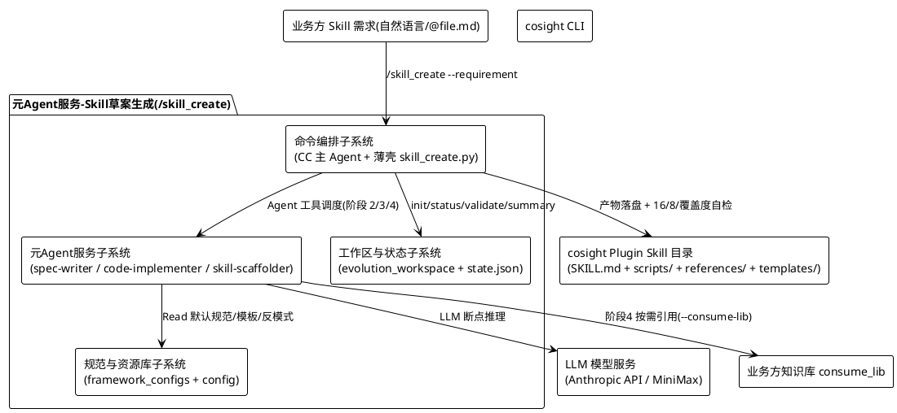
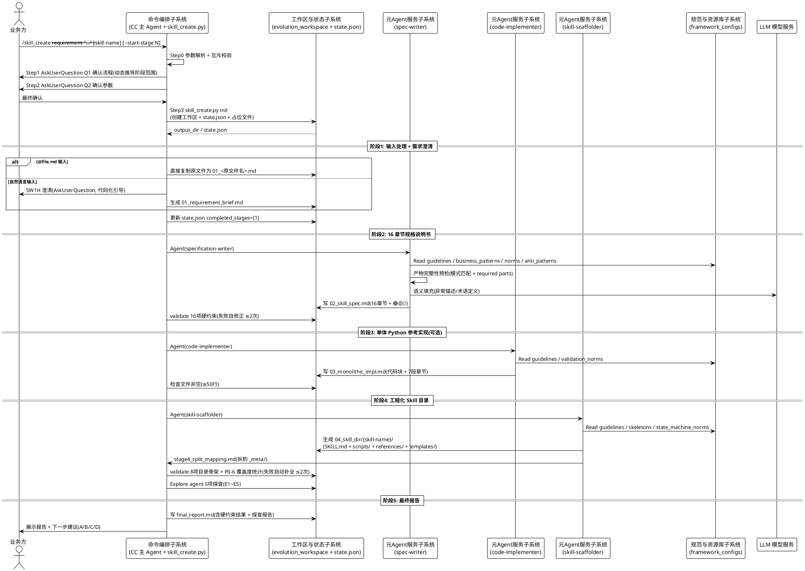
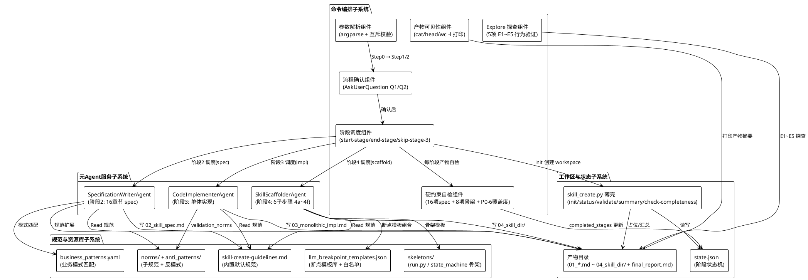
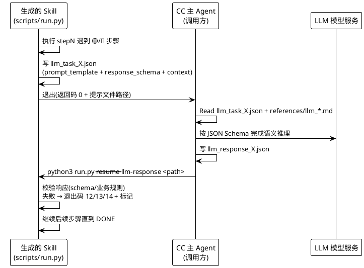
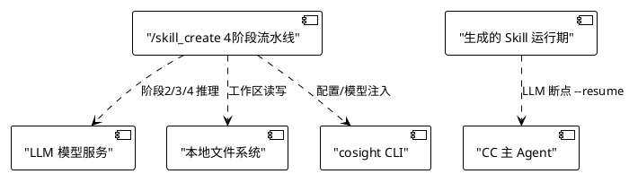

# 3 方案设计

> 对应需求：【子需求】【CoSight Pro】【下一代智慧工厂-Skill规范生产】支持高质量Skill规范化生产以及优化——元Agent服务Skill草案生成
> 对应工程：cosight-agent-core-skillx-alpha（SkillX Cosight）
> 对应命令：`/skill_create`（从 0 到 1 代码化创建 Skill）

**需求整体方案说明：**

`/skill_create` 实现"元 Agent 服务 Skill 草案生成"能力：业务方提供 **1 条自然语言需求（可附知识库路径）**，由 **CC 主 Agent 编排 + 3 个元 Agent 子服务**（规格生成 / 单体实现 / 工程化拆分）按 **4 阶段流水线（需求澄清 → 16 章节规格说明书 → 单体 Python 参考实现 → 工程化 Skill 目录）** 自动产出 **完整 cosight Plugin 形态的 Skill 目录**（`SKILL.md` + `scripts/` + `references/` + `templates/`），可直接被 CC 调用。

整体方案要点：

1. **命令编排与业务处理分离**：CC 主 Agent（Claude Code）只做参数解析、2 题二次确认、阶段调度与硬约束自检；业务逻辑全部下沉到 3 个可复用的元 Agent 服务，互不耦合。
2. **代码化优先（Code-First）**：产物每个步骤强制标注 🟢/🟡/🔴 代码化属性，🟢（纯脚本可做）占比 ≥ 50%；LLM 只在真正需要语义推理的环节介入（LLM 断点协议，`--resume` 续跑）。
3. **规范单一来源**：`framework_configs/skill-create-guidelines.md` 作为内置默认规范被 3 个元 Agent 默认加载，业务方通过 `config/create-user-config.yaml` 唯一配置入口 + `--expert-guidance` 补充特殊约束。
4. **质量三重守关**：16 项硬约束（spec）+ 8 项目录骨架（Skill 目录）+ 覆盖度统计（P0-6，6 组交叉对比），全部通过才视为完成。
5. **工作区隔离 + 状态可恢复**：产物只落在 `evolution_workspace/skill_create_*/`，禁止修改 live skill_root；`state.json` 记录阶段完成状态，`--start-stage N` 支持从中间阶段恢复。

## 3.1 特性方案设计

**特性说明**：Skill 规范化生产——元 Agent 服务将业务方 1 条自然语言需求（可附知识库）自动转化为符合"代码化 Skill 规范"的完整 Plugin 形态 Skill 草案，支持草案生成后接入 `/skill_optimize`（静态打磨）、`/skill_evolve`（评测驱动）形成四元闭环。

**特性功能列表**：
| 功能 | 对应实现 | 说明 |
|------|---------|------|
| 功能 1：Skill 草案自动生成 | `/skill_create` 4 阶段流水线 | 从 0 到 1 创建 Skill |
| 功能 2：代码化规格说明书生成 | 阶段 2 + `specification-writer-agent` | 16 章节 + 🟢/🟡/🔴 标注 |
| 功能 3：工程化 Skill 目录拆分 | 阶段 4 + `skill-scaffolder-agent` | 单体 → 独立脚本 + LLM 断点 |
| 功能 4：草案质量守关 | 16 + 8 + 覆盖度自检 + Explore 探查 | 三重校验 + 端到端行为验证 |

> 本章聚焦**功能 1（Skill 草案自动生成）**做方案设计；功能 2/3/4 作为功能 1 的内置机制在 3.1.1.2 组件协作中展开。

### 3.1.1 功能1方案设计 —— Skill 草案自动生成

#### 3.1.1.1 子系统协作设计

**子系统定义**（对齐本工程软件系统，非无线网元子系统）：

| 子系统 | 对应本工程资产 | 职责 |
|--------|---------------|------|
| **命令编排子系统** | `commands/skill_create.md` + `scripts/commands/skill_create.py` + CC 主 Agent | 接收命令、参数互斥校验、2 题二次确认、阶段调度、硬约束自检、产物可见性打印 |
| **元 Agent 服务子系统** | `agents/specification-writer-agent.md` / `code-implementer-agent.md` / `skill-scaffolder-agent.md` | 三个可复用 LLM 子服务，分别负责阶段 2/3/4 的草案内容生成 |
| **规范与资源库子系统** | `framework_configs/`（guidelines、business_patterns.yaml、llm_breakpoint_templates.json、skeletons、norms、anti_patterns）+ `config/create-user-config.yaml` | 内置默认规范、业务模式匹配、LLM 断点模板、骨架模板的唯一来源 |
| **工作区与状态子系统** | `evolution_workspace/skill_create_*/` + `state.json` | 阶段产物落盘、状态记录、`--start-stage` 恢复 |
| **外部依赖** | cosight CLI、LLM 模型服务、业务方知识库 consume_lib | 配置/模型注入、LLM 推理、领域知识引用 |

**子系统间协作时序（4 阶段流水线主流程）**：

**业务接口（业务流）清单**：

| # | 业务流 | 发起方 | 接收方 | 内容 | 变更类型 |
|---|--------|--------|--------|------|---------|
| F1 | 命令发起 | 业务方 | 命令编排子系统 | `--requirement`/`--skill-name`/`--start-stage` 等参数 | 新增 |
| F2 | 阶段调度 | 命令编排子系统 | 元 Agent 服务子系统 | 阶段序号 + 上游产物路径 + expert-guidance | 新增 |
| F3 | 规范加载 | 元 Agent 服务子系统 | 规范与资源库子系统 | Read guidelines/business_patterns/norms/anti_patterns | 继承 |
| F4 | 草案产物落盘 | 元 Agent 服务子系统 | 工作区与状态子系统 | `02_skill_spec.md` / `03_monolithic_impl.md` / `04_skill_dir/` | 新增 |
| F5 | 状态更新 | 命令编排子系统 | 工作区与状态子系统 | `state.json` completed_stages 追加 | 新增 |
| F6 | 质量自检 | 命令编排子系统 | 工作区与状态子系统 | `validate` 16/8 项 + P0-6 覆盖度 | 新增 |
| F7 | LLM 断点推理 | 生成的 Skill（运行期） | LLM 模型服务 | `llm_task_X.json` → 响应 → `--resume` | 新增 |
| F8 | 知识库引用 | skill-scaffolder | 业务方知识库 | `--consume-lib <path>` 运行时按需读取（**禁止打包**） | 新增 |
| F9 | 后续优化闭环 | 工作区与状态子系统 | `/skill_optimize` / `/skill_evolve` | 以 `04_skill_dir/{skill-name}/SKILL.md` 为输入 | 继承 |

**业务流变更说明**：
- **新增**：F1~F6、F7、F8 —— 本需求为全新能力，全部为新增业务流。
- **继承**：F3（规范加载）、F9（四元闭环复用既有 optimize/evolve 命令）复用存量能力，不发生变更。

#### 3.1.1.2 子系统内组件协作设计

**组件定义**（对齐本工程组件/模块，见 `agents/` 与 `scripts/commands/skill_create.py`）：

**组件间协作说明**：

| 协作 | 发起组件 | 接收组件 | 说明 |
|------|---------|---------|------|
| 参数→确认 | 参数解析组件 | 流程确认组件 | 互斥校验（`--skip-stage-3` 与 `--start-stage=3` 互斥）后走 Q1/Q2 二次确认 |
| 确认→调度 | 流程确认组件 | 阶段调度组件 | 依据确认结果动态推导阶段范围（1→2→3→4 或 1→2 等） |
| 调度→元 Agent | 阶段调度组件 | Specification/CodeImplementer/SkillScaffolderAgent | 按 `start/end-stage` 逐阶段调用对应元 Agent，传入上游产物路径 |
| 规范加载 | 元 Agent 服务 | 规范与资源库子系统 | 3 个元 Agent 按固定顺序 Read 默认规范（guidelines → business_patterns → norms → anti_patterns） |
| 产物落盘 | 元 Agent 服务 | 产物目录 | 阶段 2/3/4 各自产物（16 章节 spec / 单体实现 / Skill 目录） |
| 质量守关 | 硬约束自检组件 | 产物目录 | 16 项 spec 硬约束 + 8 项目录骨架 + P0-6 覆盖度（spec 声明 vs skill 实际 6 组对比） |
| 状态持久化 | 硬约束自检组件 | state.json | 每阶段通过后追加 `completed_stages`，支撑 `--start-stage` 恢复 |
| 行为验证 | Explore 探查组件 | 产物目录 | 阶段 4 后 E1~E5 探查（脚本实际行为/数据流/断点续跑/schema/协议合规） |

**软件接口（系统实现域）**：

| 软件接口 | 调用方 | 被调方 | 说明 |
|---------|--------|--------|------|
| `skill_create.py init` | CC 主 Agent（Bash） | 薄壳 | 创建工作区 + `state.json` + 阶段占位文件；路径派生链 CLI → `SKILLX_WORKSPACE` → `SKILLX_ROOT/evolution_workspace` → `config/create-user-config.yaml` |
| `skill_create.py status` | CC 主 Agent（Bash） | 薄壳 | 读取 `state.json` 展示进度与各阶段产物存在性 |
| `skill_create.py validate` | CC 主 Agent（Bash） | 薄壳 | 集成 16 项 spec 自检 + 8 项目录骨架 + P0-6 覆盖度统计 |
| `skill_create.py summary` | CC 主 Agent（Bash） | 薄壳 | 汇总工作区全部产物路径与大小 |
| `skill_create.py check-completeness` | CC 主 Agent（Bash） | 薄壳 | 通用业务完整性 checklist（目录骨架/--resume 协议/LLM 契约 JSON Schema/产物路径规范） |
| `Agent(specification-writer)` | CC 主 Agent（Agent 工具） | 元 Agent 服务 | 阶段 2，输出 `02_skill_spec.md` |
| `Agent(code-implementer)` | CC 主 Agent（Agent 工具） | 元 Agent 服务 | 阶段 3，输出 `03_monolithic_impl.md` |
| `Agent(skill-scaffolder)` | CC 主 Agent（Agent 工具） | 元 Agent 服务 | 阶段 4，输出完整 Skill 目录 |
| `Read framework_configs/*` | 元 Agent 服务 | 规范与资源库子系统 | 默认规范加载（禁止读取 `evolution_workspace/` 用户产物） |
| LLM 断点协议 | 生成的 Skill 脚本 | CC 主 Agent | `llm_task_X.json` 写入 → CC 推理 → `llm_response_X.json` → `run.py --resume --llm-response` |

**业务流输出策略（产物生成逻辑）**：
1. **阶段 1 产物名由输入形式决定**：`@file.md` → `01_<原文件名>.md`（直接复制，禁止重写）；自然语言 → `01_requirement_brief.md`（5W1H 澄清）。
2. **阶段 2 spec 结构强类型**：16 章节（§1~§N + 附录 A/B/C），每步骤含 5 字段（操作/前置/输出/校验/异常）+ 🟢/🟡/🔴 代码化属性，🟢 占比 ≥ 50%。
3. **阶段 3 载体为单 .md 文件**：1 个 Python 代码块（500~1500 行，4~6 个 dataclass + 1 个主类）+ 7 段强制 markdown 章节（文件元信息/依赖声明/LLM 兜底声明/步骤对照表/LLM 兜底说明/限制假设边界/测试验证方式）。
4. **阶段 4 = 阶段 3 单体的分布式重构**：主类 `step_N_xxx` 方法 → 独立 `scripts/step{N}_xxx.py`；dataclass → `run.py` 顶部；LLM 断点 → `references/llm_{task_id}_{business_meaning}.md` 契约（顶部强制 JSON Schema）；`stage4_split_mapping.md` 写入 `_meta/`，禁止污染 Skill 目录。
5. **产物路径规范**：`--output-dir` 默认值必须含 ≥1 层业务分类子目录（如 `${WORKSPACE}/<业务分类>/`），禁止落根目录/无语义名（`outputs/` 等）。

**LLM 断点协议（运行期交互，子 Agent 产物内嵌）**：

**软件接口变更类型**：全部为**新增**（本需求是全新能力，无存量接口被修改）；`state.json` 结构、`STAGE_FILES` 产物编号约定（阶段 1.5 已删除，阶段 2/3/4 产物 02/03/04 连续编号）为继承既有约定。

> 说明：如涉及多个功能（如功能 2 代码化规格说明书生成 / 功能 3 工程化拆分），依次按 `3.1.2 / 3.1.3` 章节展开；本章以功能 1 为主线，功能 2/3/4 作为内置机制已在上文组件协作中覆盖。

## 3.2 功能开关设计

本需求是否涉及：**不涉及**（本命令 `/skill_create` 为内部命令，无 License 开关、无功能配置开关；`config/create-user-config.yaml` 仅为业务方路径/阶段默认行为配置，非功能开关）。

> 说明：
> - 无 License 相关设计；`/skill_create` 随 SkillX Cosight 产品整体授权，不单独售卖。
> - 无功能开关（Feature Flag）设计；若后续需要灰度，建议在 `.claude/settings.local.json` 的 `env` 段增加开关项，不引入独立配置机制。

## 3.3 波及分析

### 3.3.1 需要哪些网元类型支持

本需求是否涉及：**不涉及**。

> 本需求为纯软件系统需求（CoSight Pro 元 Agent 服务），**不涉及无线网元**。部署形态支持情况：

| 部署形态 | 支持情况 | 说明 |
|---------|---------|------|
| CPaaS 平台 | 支持 | 以容器化服务部署，3 个元 Agent 服务为进程内子 Agent，无新增组件挂载组织 PVC 需求 |
| TCF 底座 | 支持 | 不依赖 TCF 新功能，仅依赖 LLM 模型服务（Anthropic API / MiniMax）与本地文件系统 |
| 智算场景（管理域/业务域升级解耦） | 不涉及 | 本需求无管理域/业务域升级耦合问题 |
| 无线网元（基站/核心网等） | 不支持 | 与本需求无关 |

### 3.3.2 需求场景检查单-<工具核查>

本需求是否涉及：**涉及**。

**表格 1：共性问题检测单**

| # | 场景检查项目 | 子检查项 | 是否涉及，是否要处理 | 具体涉及什么，方案怎么考虑 |
|---|------------|---------|---------------------|---------------------------|
| 1 | 智算场景 | 管理业务升级解耦 | 不涉及 | 无升级解耦诉求 |
| 1 | 智算场景 | MagicFlow SDK 变更 | 不涉及 | 未引入 MagicFlow |
| 1 | 智算场景 | text2Sql（dataagent-structk）SDK 变更 | 不涉及 | 未引入 text2Sql |
| 1 | 智算场景 | zagents-framework SDK 变更 | 不涉及 | 未引入 zagents-framework |
| 1 | 智算场景 | 波及组件是否涉及新增挂载组织 PVC（需同步智算场景动态扩容） | 不涉及 | 元 Agent 服务为进程内子 Agent（Agent 工具调度），无新增 PVC |
| 2 | 用户操作方式变更 | GUI 变更 | 不涉及 | 无 GUI 变更；新增 `/skill_create` slash command（命令层），走 AskUserQuestion 交互，非 GUI 操作 |
| 2 | 用户操作方式变更 | 操作方式变更 | 涉及 | 新增 `/skill_create` 命令入口，业务方需按命令契约传 `--requirement` 等参数；使用方式见 [skill_create-功能介绍.md](skill_create-功能介绍.md) |
| 2 | 用户操作方式变更 | 资源使用情况（CPU\|MEM\|IO）变化 | 涉及 | 阶段 2/3/4 依赖 LLM 模型服务推理，产生 LLM 调用 token 成本与推理时延；经模型配置（`.claude/settings.local.json` env 段）控制，单次创建典型耗时分钟级；框架侧不新增常驻进程 |
| 2 | 用户操作方式变更 | 北向功能变更 | 不涉及 | 无北向接口 |
| 2 | 用户操作方式变更 | 功能使用限制（默认不建议有限制） | 不涉及 | 无新增操作限制；`--skip-stage-3`/`--start-stage` 等均为参数选项而非限制 |
| 2 | 用户操作方式变更 | 鉴权项，操作码 | 不涉及 | 无新增鉴权项；沿用现有命令执行授权 |
| 3 | 兼容性 | 对系统升级的影响分析 | 涉及 | 本需求为新增命令，不修改存量命令（`/skill_evolve`/`/skill_optimize`）行为，平滑升级；`state.json` 结构新增字段均带默认值，兼容旧工作区 |
| 3 | 兼容性 | 接口兼容 | 不涉及 | 无外部接口变更 |
| 3 | 兼容性 | 业务兼容（新/老 Skill 兼容） | 涉及 | 生成产物遵循 `skill-create-guidelines.md` 目录规范（SKILL.md + scripts/ + references/ + templates/），与 step4 V2 一致，可被现有 `/skill_optimize`/`/skill_evolve` 直接消费；LLM 断点契约兼容旧 `stepN-rules.md` 命名（WARN 不阻断，v2 起推荐 `llm_*.md`） |
| 3 | 兼容性 | 北向兼容性 | 不涉及 | 无北向规范约束 |
| 4 | openapi | 是否新增或修改 api 接口 | 不涉及 | 无 OpenAPI 变更 |
| 5 | 其他规则 | 数据库差异（Gbase、GP、AP） | 不涉及 | 无数据库依赖 |
| 5 | 其他规则 | 运行平台（CPaaS、TCF） | 支持 | 见 3.3.1 |
| 5 | 其他规则 | TCF 底座和产品升级解耦 | 支持 | 不依赖 TCF 新功能，仅依赖 LLM 模型服务与本地文件系统 |
| 5 | 其他规则 | 文件清理 | 涉及 | 过程产物：`01_*.md`/`02_skill_spec.md`/`03_monolithic_impl.md`/`04_skill_dir/`/`final_report.md` 均为工作区中间产物（`evolution_workspace/skill_create_*/`）；默认保留不清理（供回归/复盘），由运维定期清理历史 taskid 目录；禁止产物落 live skill_root |
| 6 | 对系统测试影响识别 | 是否涉及测试工具开发适配 | 涉及 | 需验证 4 阶段流水线端到端可用（mock LLM + 真实 LLM 两档）；框架自带自测脚本（`scripts/test_postfix_bugs.py`、`test_eval_time_copy.py`、`mock_llm_server.py`），建议提前 2 周提需求给测试补充 `/skill_create` 命令级用例 |
| 6 | 对系统测试影响识别 | 是否涉及大容量测试 | 不涉及 | 无大容量指标诉求 |
| 7 | 通用典型异常分析 | 业务主键重复有脏数据 | 不涉及 | 无数据库主键 |
| 7 | 通用典型异常分析 | 其他业务通用异常 | 涉及 | 工作区路径漂移（已根治：路径派生链强制环境变量/config）；Skill 名重复（同一 taskid 目录互不干扰）；产物文件为空（`validate` 硬校验拦截） |
| 8 | 易用性 | 耗时与执行时间参考提醒 | 涉及 | 阶段 2/3/4 LLM 推理耗时较长，Q1/Q2 二次确认时明确提示用户"阶段范围"，支持 `--end-stage` 提前止损、`--start-stage` 断点续跑 |
| 8 | 易用性 | 操作前一次性核查所有异常 | 涉及 | Step 3 前置检查（init 前确认 `SKILLX_WORKSPACE`/`SKILLX_ROOT`）、互斥参数校验（`--skip-stage-3` 与 `--start-stage=3` 冲突即报错） |
| 8 | 易用性 | 操作限制新增或变更 | 不涉及 | 无 |
| 9 | 操作安全类-防呆设计 | 项目的危险操作 checklist | 不涉及 | 无危险操作（只读 + 工作区写，禁止改 live skill_root） |
| 9 | 操作安全类-防呆设计 | 【UX】防呆设计原则 | 涉及 | Q1/Q2 二次确认 + 1 句最终确认（Step 1/2），防误触发 4 阶段流水线；`--no-interactive` 为显式参数才跳过 |
| 9 | 操作安全类-防呆设计 | 【架构】防呆设计原则与规范 | 涉及 | init 路径派生链 + `is_relative_to(workspace_root)` 防漂移校验（漂出 evolution_workspace 即报错退出） |
| 9 | 操作安全类-防呆设计 | OpenAPI 防呆设计规范 | 不涉及 | 无 OpenAPI |
| 9 | 操作安全类-防呆设计 | 脚本安全规范 | 涉及 | 生成脚本语言由 `expert-guidance` 声明（py/sh），产物 `run.py` 支持 `--help`/`py_compile`/mock 试跑三件套验证 |
| 10 | 操作安全类-金库 | 新增功能是否需金库管控 | 不涉及 | 无资金/敏感操作 |
| 11 | 操作安全类-防夹带 | 防夹带 checklist | 不涉及 | 无夹带风险 |
| 12 | 操作安全类-安全授鉴权 | 项目安全授鉴权规范 | 不涉及 | 无新增鉴权项；沿用现有命令执行授权 |
| 13 | 操作安全类-日志 | 审计日志开发规范 | 涉及 | 阶段产物 + `final_report.md` 记录完整执行轨迹（中间产物可见性强制打印），满足审计追溯要求；LLM 断点任务/响应 JSON 落盘留痕 |
| 14 | 项目变更申请波及自查 | UME 业务相关各申请和项目规范指引 | 不涉及 | 无 UME 业务申请变更 |
| 15 | 新引入有交互入口组件变更 | 新引入变更组件安全自查 | 不涉及 | 无新引入外部交互组件 |
| 16 | 常见故障 | 各项目常见故障 checklist | 涉及 | LLM 模型服务不可用 → 元 Agent 降级写 `.skipped.md` 标注重试；16/8 项自检 2 次失败 → 写部分产物标注"需用户手动补全" |
| 17 | 市场\|可服需求操作日志埋点 | 各项目日审计规范链接 | 不涉及 | 无新增埋点 |

**表格 2：业务场景分析核对**

| 大类 | 要考虑的业务场景 | 详细因素补充 | 是否涉及 | 具体涉及什么，方案怎么考虑 |
|------|----------------|-------------|---------|---------------------------|
| 组网\|环境相关 | IPV6 单栈 / 双栈 / 南北向分离等 | — | 不涉及 | 无网络拓扑诉求；产物为本地文件 + LLM API 调用，走标准 HTTP(S) |
| 组网\|环境相关 | 时区、夏令时 | 时间参数应以 UTC 通信 | 涉及 | `state.json` 的 `created_at` 用 ISO8601（`timespec="seconds"`），taskid 用本地时间戳（`YYYYMMDD_HHMMSS`）；时间仅用于目录命名与状态记录，不做跨时区通信，UTC 表示即可 |
| 安全相关 | 个人数据保护 | — | 涉及 | 输入需求/知识库可能含个人数据；产物落 `evolution_workspace/`（内部），不转移出系统边界；详见 3.3.5 安全设计 |
| TCF 相关性 | 是否与 TCF 相关 | — | 部分功能相关：`/skill_create` 阶段 2/3/4 的元 Agent 服务 | 不依赖 TCF 新功能，仅依赖 LLM 模型服务；见 3.3.1 |

**特性检查单**（无存量特性库条目，本需求为全新特性，不适用自动继承；BA 补充以下关键项）：

| # | 检查大项 | 检查小项 | 是否涉及 | 具体说明 |
|---|---------|---------|---------|---------|
| 1 | 产物规范 | 目录骨架 4 大类 | 涉及 | SKILL.md + scripts/ + references/ + templates/，8 项目录骨架自检强制 |
| 2 | 质量门槛 | 16 项 spec 硬约束 | 涉及 | 含 🟢 占比 ≥ 50%、无软化措辞、无绝对路径硬编码 |
| 3 | 断点协议 | LLM 断点 + --resume | 涉及 | 退出码 10 哨兵 + llm_task/response JSON 续跑 |
| 4 | 覆盖度 | spec 声明 vs 产物 6 组对比 | 涉及 | P0-6 覆盖度统计（步骤/断点/概念/产物/业务模式） |

### 3.3.3 性能设计

本需求是否涉及：**涉及**（LLM 推理环节）。

| 功能 | 是否波及 | 是否支持批量操作 | 用户操作限制说明 | 大容量效率 | 是否有业务指标 |
|------|---------|----------------|-----------------|-----------|---------------|
| 阶段 1 输入处理 | 是 | 是（`@file.md` 批量复制） | 无 | O(文件大小) | 产物 ≤ 原文件大小 |
| 阶段 2 规格说明书生成 | 是 | 否（单 Skill 串行） | LLM 推理单次，无并发 | token 成本与 spec 长度成正比；16 章节模板约束 ≤ 阈值（条件章节按 brief 增量） | 🟢 步骤占比 ≥ 50%（代码化导向，降低 LLM 调用） |
| 阶段 3 单体实现 | 是 | 否 | 可 `--skip-stage-3` 跳过（省约 30% 时间） | 代码块 500~1500 行约束，防过度抽象 | 无 |
| 阶段 4 工程化拆分 | 是 | 否 | 无 | scripts 数 ≤ spec 步骤数 + 1 + 3（3 个 validate 配额） | references/ 单目录 ≤ 1 MB、单文件 ≤ 200 KB（防 GB 级知识库打包，P0-7） |
| 质量自检 | 是 | 是（`check-completeness` 批量校验） | 无 | 正则/文件扫描为主，无 LLM 调用，毫秒级 | 16 + 8 + 覆盖度全部通过 |

**性能设计说明**：
- 模型选择遵循性能优化规则：元 Agent 服务（spec-writer/code-implementer/skill-scaffolder）默认 `model: sonnet`（最优性价比）；LLM 只介入 🟡/🟢 之外的真语义点。
- 无大容量/高并发诉求：`/skill_create` 为交互式命令，单用户单次创建 1 个 Skill，无批量创建、无并发压测指标。
- 上下文管理：阶段产物分文件落盘（01/02/03/04），避免单文件超大（spec ≥ 800 行但有上限治理、impl 500~1500 行）。

### 3.3.4 可靠性设计

本需求是否涉及：**涉及**。

可靠性设计必须按功能粒度，与特性体系化-本需求波及功能（功能 1 Skill 草案自动生成）一致。

**系统交互可靠性**（外部依赖）：

**可靠性设计点（按功能粒度）**：

| 功能/环节 | 失效场景 | 影响 | 可靠性设计 | 处理方式 |
|----------|---------|------|-----------|---------|
| 阶段 1 输入处理 | 输入文件不存在 | 流程中断 | 前置检查 + 报错退出 | `--requirement @file.md` 文件缺失 → exit code 2 + 明确提示 |
| 阶段 2 规格生成 | LLM 调用失败 | 无 spec | 元 Agent 失败降级 | 写 `02_skill_spec.md.skipped.md` 标注"LLM 调用失败，需重试" |
| 阶段 2 规格生成 | 16 项硬约束自检不通过 | 产物不合格 | 自修正循环 | CC 触发 LLM 自我修正 ≤ 2 次；仍失败写部分产物 + 标注"需用户手动补全" |
| 阶段 3 单体实现 | LLM 调用失败 / 7 段章节缺失 | 无 impl | 降级 + 完整性标注 | 写 `.skipped.md` / `.incomplete.md` 标注缺段 |
| 阶段 4 工程化 | 8 项目录骨架自检不通过 | Skill 不可调用 | scaffolder 自动补全 ≤ 2 次 | 自动补全；仍失败标注"自检失败" |
| 阶段 4 工程化 | 产物行为跑飞（骨架像但 bug） | Skill 运行异常 | Explore 探查（E1~E5） | 阶段 4 后强制 Explore agent 探查，发现问题进 final_report，作为 `/skill_optimize` 输入 |
| 全流程 | 中断/强杀 | 进度丢失 | 状态机持久化 | `state.json` 记录 `completed_stages`，`--start-stage N --spec-path` 断点续跑；产物文件占位保真 |
| 全流程 | 工作区路径漂移 | 产物落错目录 | init 防呆 | 路径派生链 + `is_relative_to(workspace_root)` 校验，漂出即报错退出 |
| 全流程 | 知识库误打包 | Skill 包膨胀（GB 级） | P0-7 防呆 | references/ 单目录 > 1 MB 或单文件 > 200 KB → FAIL，强制改 `--consume-lib` 运行时引用 |
| 生成 Skill 运行期 | LLM 断点响应非法 | 流程卡死/脏数据 | 契约 + 校验 | `references/llm_*.md` 顶部强制 JSON Schema；schema 校验失败退出码 12/13/14 + diff 输出；`validate_or_revert()` revision loop 回退 |
| 生成 Skill 运行期 | 阻断（上游产物缺失） | 流程中断 | 阻断追溯报告 | 写 `<step_num>_block_report.json`（含 block_type/row_index/suggestion），供调用方读取修复 |

**可靠性红线 FMEA 设计参考点**（对应框架 `llm_checkpoint_sentinel_v1.md` / `state_machine_norms.md`）：
- **LLM 断点退出码**：等待 LLM 必须 `exit 100`（哨兵），禁止 `exit 0`（否则 `if ! bash` 无法捕获，被视为成功继续导致断点失效）。
- **状态机包裹 revision loop**：`validate_or_revert()` 在 LLM 响应校验失败时回退到 pending 状态，防止脏数据进入下一阶段。
- **中间产物可见性**：每个阶段产物生成后强制 `cat`/`head`/`wc -l`/`find` 打印，禁止静默写文件（便于故障定位）。

### 3.3.5 安全设计

本需求是否涉及：**涉及**。

#### 3.3.5.1 安全威胁建模和分析矩阵-<SME核查>

| # | 检查 | 威胁建模输出 | 对应方案内容 |
|---|------|------------|------------|
| 1 | WXSEC 链接 | 待补充（SME 核查） | — |
| 2 | WXSEC 截图：威胁建模的对应需纳入的"威胁和控制措施" | 待补充 | 主要威胁面：LLM 断点契约注入、prompt injection、敏感数据（需求/知识库可能含个人数据）外泄 |

**STRIDE 威胁模型核心结论**：

| STRIDE 威胁 | 威胁场景 | 风险控制防御措施 | 检查结果 |
|------------|---------|----------------|---------|
| 仿冒(S) | 伪造需求/知识库内容诱导元 Agent 产出恶意 Skill | 信任边界校验：产物仅在工作区；不执行生成的 `SKILL.md`/脚本（只写不跑），由调用方人工/`--check` 验证后再用 | 待确认 |
| 篡改(T) | LLM 响应被篡改 | `references/llm_*.md` 契约含 JSON Schema + schema 校验（`jsonschema.validate`）+ 退出码 12/13/14 | 待确认 |
| 信息泄露(I) | 需求/知识库含个人数据；产物含敏感信息 | 产物落内部 `evolution_workspace/`，不转移出系统边界；日志/提示信息不暴露敏感数据；个人数据如必须处理做 HASH（HMAC-SHA256） | 待确认 |
| 拒绝服务(D) | LLM 调用异常消耗资源 | `--end-stage`/`--skip-stage-3` 提前止损；单次创建交互式串行，无并发放大 | 待确认 |
| 权限提升(E) | 产物脚本越权操作 | 生成的 Skill 脚本语言/工具由 `expert-guidance` + frontmatter `allowed-tools` 白名单约束；框架只写工作区，禁止改 live skill_root | 待确认 |

#### 3.3.5.2 安全检查单

| 检查大类 | 检查小类 | 具体检查项 | 检查结果 |
|---------|---------|-----------|---------|
| 出口合规 | 采用技术 | 是否需要采用美国技术（LLM 模型服务需确认：Anthropic API / MiniMax，如涉及美国技术须上报中心 ECPOC 沟通确认） | 待确认 |
| 出口合规 | 提出方/来源 | 需求提出方/来源是否禁运国/地区和受制裁主体 | 否 |
| 出口合规 | 目的 | 需求目的是否涉及军事/监视/监听 | 否 |
| 出口合规 | 实现过程 | 需求实现过程是否需要与美国人沟通 | 待确认 |
| 个人数据保护 | 是否包含个人数据 | 输入需求/知识库可能含个人数据（如示例数据、联系方式）；产物为 Skill 代码/文档，一般不含个人数据；需按个人数据识别规范核查 | 待确认 |
| 个人数据保护 | 新增个人数据相关的功能是否已经审批 | 如需新增需单独审批 | 待确认 |
| 个人数据保护 | 个人数据相关特性是否已做 DPIA | 以特性为粒度核查 | 待确认 |

**STRIDE 防御措施落地要点**（本需求）：
- 认证凭证/密码：LLM 断点任务/响应 JSON 不写入任何认证凭证；API Token 走 `.claude/settings.local.json` env 注入，禁止出现在产物中。
- 通讯链路：元 Agent 服务经 LLM API 走 HTTPS（TLS ≥ 1.2）；生成的 Skill 内 LLM 断点由 CC 主 Agent 本地处理，无新增网络端口。
- 日志：`final_report.md`/阶段产物为审计记录；日志/提示信息不暴露 Token、路径中的敏感段（如需则脱敏）。
- 最小权限：产物只在工作区读写；禁止对 live skill_root 的修改；`allowed-tools` 白名单约束生成 Skill 的工具面。

#### 3.3.5.3 安全低级问题检查

| 安全大类 | 检查点 | 是否波及 | 具体涉及什么，方案怎么考虑 |
|---------|-------|---------|---------------------------|
| 安全低级问题 | 明文密码、硬编码、弱密码等 | 不涉及 | 产物无凭据；配置走环境变量（`.claude/settings.local.json` env 段 + `config/create-user-config.yaml` 占位符 `${SKILLX_ROOT}`），禁止硬编码绝对路径/密钥 |
| 安全低级问题 | Prompt 注入（生成的 Skill 被恶意提示词操纵） | 涉及 | `framework_configs/static-eval-config.yaml` 的 `dim11_safety` 维度（关键词扫描 prompt injection，命中 ≥2 条 reject）供 `/skill_optimize` 对产物做安全自检；`/skill_create` 阶段 2 spec 反模式清单含 prompt 安全要求 |

### 3.3.6 交付文档

本需求是否涉及：**涉及**。

| 文档（除版本说明外，如工程操作手册） | 是否涉及 | 补充链接 | 备注 |
|--------------------------------------|---------|---------|------|
| 内部变更评审发布并评审通过（接口变更、接口能力变更、服务依赖变更） | 涉及 | 本方案设计 | 需评审通过后发布 |
| 相关工程操作手册 | 涉及 | [user手册](user手册.md) / [产品手册](产品手册.md) | `/skill_create` 命令使用说明 |
| 版本说明 | 涉及 | — | 版本说明补充 `/skill_create` 命令条目 |
| 帮助手册 | 涉及 | [skill_create-功能介绍.md](skill_create-功能介绍.md) | `/skill_create` 功能介绍（4 阶段流水线/参数/设计哲学） |
| **变更文档**：GUI 和界面变更 / OpenAPI / 用户权限变更 | 不涉及 | — | 无 GUI/OpenAPI/权限变更 |
| 其他，请补充 | 涉及 | [skill-create-用例-组件间流程设计.md](skill-create-用例-组件间流程设计.md) | 实战案例（从 step1 思路 → 完整 Skill 的演示）；[how-to-self-test.md](how-to-self-test.md) 自测方法 |

## 附：本方案涉及的工程关键资产索引

| 类别 | 资产 | 说明 |
|------|------|------|
| 命令契约 | [commands/skill_create.md](../commands/skill_create.md) | 命令行为契约（含 12 项硬约束） |
| 薄壳实现 | [scripts/commands/skill_create.py](../scripts/commands/skill_create.py) | init/status/validate/summary/check-completeness |
| 元 Agent 服务 | [agents/specification-writer-agent.md](../agents/specification-writer-agent.md) | 阶段 2 |
| 元 Agent 服务 | [agents/code-implementer-agent.md](../agents/code-implementer-agent.md) | 阶段 3 |
| 元 Agent 服务 | [agents/skill-scaffolder-agent.md](../agents/skill-scaffolder-agent.md) | 阶段 4 |
| 内置规范 | [framework_configs/skill-create-guidelines.md](../framework_configs/skill-create-guidelines.md) | 代码化 Skill 制作规范 |
| 业务配置 | [config/create-user-config.yaml](../config/create-user-config.yaml) | 业务方唯一配置入口 |
| 工程总览 | [COSIGHT.md](../COSIGHT.md) | 四元闭环整体架构 |
