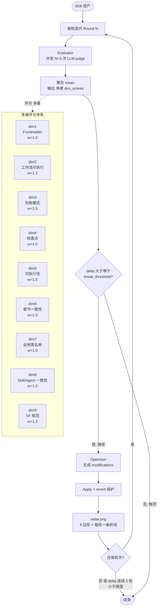

# `/skill_optimize`  算法说明

> **核心模型**:多轮 hill-climb + 每轮 多维 LLM judge 评分 + 触顶 break + 雷达图可视化。
> ** =  + 9 边形雷达图**: 删 dim8_assets 扩展到 多维; 收尾生成 `radar.png`,每轮一条折线。

## 算法总览



---

## 多维评分维度详解

每轮 Evaluator 并发跑 N=3 次 LLM judge,按 9 个维度对 Skill 资产打分(0~10),再加权聚合为百分制总分。

### dim1 · Frontmatter 完整度(weight 1.0)

**衡量什么**:SKILL.md 文件头部 YAML 元数据的完整度与触发词质量。Frontmatter 是 Agent 决定是否加载该 Skill 的唯一依据,质量差等于"Skill 隐身在 Agent 视野外"。

**评分要点**:
- 必须含 `name` + `description` 字段
- `description` 包含"做什么 + 何时用 + 触发词"三要素(动词具体,如"创建/分析/评审/优化")
- `description` 长度 ≤ 1024 字符,无空话尾巴
- `input` / `output` 声明清晰
- 若含 `protected_assets` 字段,格式正确(YAML 数组)
- 长度 < 10 字符或不含动词 → 扣 ≥ 3 分(命中 SAP2)

**典型低分 → 高分**:
- 低分:`description: 处理相关任务` / `用于 Skill 优化`
- 高分:`description: 评审/优化 Skill 资产,识别 8 类反例,产出可应用的 modifications`

---

### dim2 · 工作流可执行性(weight 1.2)

**衡量什么**:SKILL.md 中描述的执行流程能否被 Agent 直接照做。模糊步骤、缺失序号、缺输入输出,都会让 Agent 自由发挥导致行为漂移。

**评分要点**:
- 步骤有明确开始/结束、有序号(H3 编号或有序列表)
- 步骤描述无歧义,Agent 可直接执行(无需二次猜测)
- 命令行示例含完整 `--flag value` 实例(避免裸 `python3 xxx.py`,命中 SAP3 扣分)
- 输入输出明确(写"看到 X 才继续" / "输出 Y 才算成功")
- 流程闭环(开始 → 处理 → 输出)

**典型低分 → 高分**:
- 低分:`## 执行步骤\n1. 运行脚本\n2. 看结果`(缺 flag、缺检查点、缺闭环)
- 高分:`## 执行步骤\n1. python3 review.py --input {path} --output {dir}\n   看到 "PASS" 才继续\n2. 校验产物:...`

---

### dim3 · 失败模式覆盖(weight 1.5,杠杆点 HL-2)

**衡量什么**:Skill 是否显式列出失败类型 + 处理策略。只说"重试"等于没处理,Agent 真遇到失败会原地卡死。

**评分要点**:
- 显式列出 ≥ 3 类失败(网络错误/超时/参数缺失/权限不足/文件不存在等)
- 每类失败用"三段式":**触发条件 / 一线修复 / 仍失败兜底**(HL-2 杠杆点,4 行改动撬动 +4 分)
- 失败处理必须含:重试次数 + 退避策略(如 `sleep 5`)+ 退出条件
- 失败处理段至少 1 处 🔴 STOP 视觉标记
- 仅写"重试"无参数 → 命中 SAP5,扣 ≥ 3 分

**典型低分 → 高分**:
- 低分:`## 失败处理\n如果失败,请重试`
- 高分:
  ```
  ## 失败处理
  - 网络超时(sleep > 5s):一线 sleep 5 + 重试 1 次;仍失败 → 切换到 offline cache
  - 参数缺失(exit code 2):🔴 STOP 报 "缺少 --input,见 usage";不重试
  - 权限拒绝(exit code 13):fallback 到只读模式,产物写到 {work_dir}/readonly/
  ```

---

### dim4 · 检查点设计(weight 1.0,杠杆点 HL-1)

**衡量什么**:关键节点是否设置了可验证的"看到 X 才继续"标记。Agent 缺检查点会一路向前冲,错也照跑。

**评分要点**:
- 关键节点有可验证检查("看到 X 才继续" / "输出 Y 才算成功")
- 副作用操作(写文件/删文件/调用外部 API)有回滚说明
- 使用 🔴 STOP 或 CHECKPOINT 等视觉标记(不是"如果...建议..."这种软话)
- 至少 2 处显式检查点
- 连续 > 3 个步骤无检查点 → 命中 SAP4,扣 ≥ 3 分
- 杠杆点 HL-1:插入 🔴 STOP 视觉标记,4 行改动可撬动 +3 分

**典型低分 → 高分**:
- 低分:`1. 读取数据\n2. 处理\n3. 写文件`(无任何检查点)
- 高分:`1. 读取数据\n   🔴 STOP:看到 JSON 长度 > 0 才继续\n2. 处理...\n   看到 "transformed" 才继续\n3. 写文件\n   回滚:产物先写 .tmp,验证后再 rename`

---

### dim5 · 可执行具体性(weight 1.5)

**衡量什么**:步骤描述是否"硬"——含操作 + 参数 + 具体路径。避免软化措辞(建议/灵活/根据情况/视情况而定),这类词 = Agent 自己脑补 = 行为不可控。

**评分要点**:
- 禁软化措辞:"建议 / 灵活 / 根据情况 / 视情况而定 / 可能" 等(每出现 1 次扣 0.5 分,≥ 3 处扣 ≥ 3 分)
- 步骤描述具体到 **操作 + 参数**(如 `python3 xxx.py --flag value` 而非"运行脚本")
- 条件分支明确("如果 X 则 Y" 而非"可能需要...")
- 命令行示例含完整 flag 和参数(命中 SAP3 扣分)

**典型低分 → 高分**:
- 低分:`根据情况,灵活地运行处理脚本,可能需要根据结果调整参数`
- 高分:`python3 transform.py --input {input} --output {output} --format json --strict`

---

### dim6 · 章节一致性(weight 1.0)

**衡量什么**:SKILL.md 内部各章节之间是否自洽。章节矛盾 / 引用断裂 / 术语混用,都会让 Agent 行为漂移。

**评分要点**:
- 跨章节引用闭合(## A 提到 ## B,## B 必须存在)
- 章节间无矛盾(A 说"先 X 再 Y",B 不能说"先 Y 再 X",命中 SAP7 扣分)
- 术语全文一致(无"评测/评价/评估"混用,选 1 个统一)
- 版本号 / 字段名 / 引用路径前后一致
- 流程闭环:开始 → 处理 → 输出,无悬空步骤

**典型低分 → 高分**:
- 低分:`## A: 先评测再优化` + `## B: 先优化再评测`(章节矛盾)
- 高分:`## A: 先评测再优化` + `## B: 接收 A 的评测结果,执行优化`(依赖闭合)

---

### dim7 · 反例与黑名单(weight 1.0)

**衡量什么**:SKILL.md 自身是否含"不要做什么"反例清单。LLM 自评命中率仅 46.4%——必须显式写反例,Agent 才不会复现。

**评分要点**:
- SKILL.md 自身含"反例" / "反模式" / "不要做"清单(无则扣 ≥ 3 分)
- 不命中 `skill_anti_patterns` 8 条(SAP1~SAP8)
- 每命中一条扣 1.5 分
- 显式列反例的 SKILL 比未列出的更优

**SAP 8 条**:
1. SAP1 描述模糊(`处理相关任务`)
2. SAP2 触发词缺失(< 10 字符或无动词)
3. SAP3 示例无 flag(裸 `python3 xxx.py`)
4. SAP4 步骤无检查点(连续 > 3 步无验证节点)
5. SAP5 失败处理空泛(只说重试,不说次数/退出)
6. SAP6 资源路径硬编码(`/media/vdb/...`)
7. SAP7 章节冲突(A 步骤顺序 ≠ B 章节)
8. SAP8 LLM 自评幻觉(`准确率达 X%` 无验证方法)

---

### dim8 · Skill/Agent 全局一致性(weight 1.0, 新增)

**衡量什么**:Skill 在所在 Agent 中是否对齐 role / tools / I-O / safety / review。Skill 单看合理,但越权 / 偷用路径 / 绕过审查 → 全局不一致。

**评分要点**(AgentGenesis GC-1~GC-7):
- GC-1 **Role 一致性**:Skill 不越权(执行修改操作前对照 Agent `safety_constraints`,CRITICAL)
- GC-2 **Tool 权限**:Skill 用到的工具必须在 Agent 白名单内(HIGH)
- GC-3 **I/O 路径约定**:Skill 输出路径与 Agent `work_dir_convention` 对齐,不偷用 `/tmp`(HIGH)
- GC-4 **Safety 约束**:Skill 不绕过 Agent 审查门禁(self_review 不能代替 G1 reviewer)(HIGH)
- GC-7 **Review 策略**:Skill 自审不替代 Agent G1 独立审查(MEDIUM)

**适配场景**:单 Skill 模式(无 Agent COSIGHT.md 对比基准)→ 自动 PASS 8/10。

---

### dim9 · Anthropic Skill 规范合规 / SF(weight 1.2, 新增)

**衡量什么**:SKILL.md 是否符合 Anthropic 官方 SF-1~SF-8 结构规范。违规 → Skill 难以分发到其他 runtime / Agent 加载失败 / description 触发不到。

**评分要点**(SF-1~SF-8):
- SF-1 **目录结构**:`> 200 行` 必有 `references/` 分层
- SF-2 **description 质量**:≥ 20 字符,Agent 可判断触发时机
- SF-3 **行数限制**:SKILL.md 不超过 500 行(强制 L2 渐进加载,超则 L3 拆 references)
- SF-4 **L3 引用闭合**:`references/` 中每个文件必须被 SKILL.md 引用(无孤立文件)
- SF-5 **命名约定**:kebab-case + 领域关键词,避免 `helper / utils / tool / misc / common` 等宽泛名
- SF-6 **description 公式**:`做什么 + 何时触发 + 输入 + 输出` 四要素(缺一扣分)
- SF-7 **脚本提取**:可执行脚本应放 `scripts/` 而非 inline 在 SKILL.md
- SF-8 **模板沉淀**:≥ 3 步骤的流程应有 `templates/` 提供可复用模板

**评分**:全 PASS = 8/10;每项 -1 分;**SF-1 + SF-5 + SF-6** 三项中 ≥ 2 项违规 → severity=HIGH。

---

## 关键参数

| 参数 | 默认 | 含义 |
|------|------|------|
| `--max-rounds` | 3 | 主循环最大轮次 |
| `--eval-runs` | 3 | 每轮 evaluator 并发跑 N 次取均值 |
| `--break-threshold` | 2.0 | 触顶 break 阈值(Δ 连续 2 轮小于即停) |
| `modification_budget` | 8→7→6...floor 2 | 单轮 modifications 上限(随轮次递减) |
| `MAX_VOLUME_RATIO` | 1.5 | 体积膨胀上限 |
| `protected_assets` | 3 层合并白名单 | 永不被改 |

## 关键文件

| 文件 | 作用 |
|------|------|
| `scripts/optimizers/static_optimizer.py` | 主循环 + 6 phase 调度 + 触顶 break |
| `scripts/optimizers/static_agents.py` | LLM judge 并发(默认 3 次) |
| `scripts/optimizers/static_apply.py` | modifications 应用 + 资产校验 |
| `scripts/optimizers/static_radar.py` |  matplotlib 雷达图渲染 |
| `framework_configs/static-eval-config.yaml` | 多维 rubric + 8 反例 + 4 HL |
